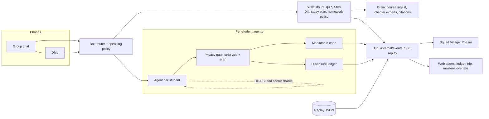

# Squad

Study-group agents for the group chats students already use. An `@cubbie` bot answers from your own course files with citations, per-student agents plan study sessions and trips together without exposing calendars or budgets, and a walkable pixel village shows it all happening in real time.

Entered in Track 3 (group chat) and Track 2 (agents) of the Cubbie hackathon. One shared core runs both.

- Track 3 walkthrough: [docs/demo/track3/README.md](docs/demo/track3/README.md)
- Track 2 walkthrough: [docs/demo/track2/README.md](docs/demo/track2/README.md)
- Judge Q&A: [docs/demo/QA.md](docs/demo/QA.md), video scripts: [docs/demo/video/](docs/demo/video), submission: [docs/submission/](docs/submission)
- Specs: `docs/specs/` (start with `00-OVERVIEW.md`), decisions: `docs/DECISIONS.md`

## Replay demo in 5 minutes

The Replay needs no API keys and no phones. It plays a scripted run of real `VillageEvent`s through the same village code path as Live, with a visible Replay badge.

```sh
git clone https://github.com/vaibav03/squad.git && cd squad
corepack enable            # or: npm i -g pnpm   (Node >= 20)
pnpm install
cp .env.example .env       # replay needs no keys
pnpm demo:seed             # seed pack: 4 students, calendars, lodging, OpenStax course reference
pnpm demo:replay track2    # or: pnpm demo:replay track3
```

`demo:replay` validates the script, starts the hub, and opens `http://localhost:5173/squad/village?replay=track2`. Use `--no-open` to skip the browser. Run `pnpm demo:preflight` first to check env, keys, hub health, replay validity and that no withheld value leaked into any script. `pnpm demo:reset` reseeds and rewinds the village between runs.

Replay scripts live in `apps/hub/sim/replays/` and are validated against `@squad/core` (`validateReplay`) in CI.

## How it works



- Every emitter POSTs `VillageEvent`s to the hub (`/internal/events`). The village and web pages only consume events; they never invent behavior and never receive a withheld value.
- Live and Replay take the same path (`?replay=<name>` swaps the source), so the visuals are identical.
- The mediator is deterministic code. LLMs talk to their own student and explain results; they never negotiate and never see another student's raw data.
- Workspaces: `apps/{bot,agent,hub,web-host}`, `packages/{core,brain,mesh,media,village,web}`.

## Privacy and trust

Taken from `docs/specs/04-agent-mesh-trip-planner.md`. We call it "privacy-preserving" using PSI plus secure aggregation. It is not zero-knowledge.

| Truly cryptographic (semi-honest model)                       | Data minimization (trust our code)           |
| ------------------------------------------------------------- | -------------------------------------------- |
| Common free slots and dates (DH-PSI on ristretto255)          | The privacy gate and its strict zod schemas  |
| Budget, veto, vote and topic counts (additive secret sharing) | Each agent truthfully computing its own bits |
|                                                               | Students' DMs and the ledger itself          |

Limits we state: semi-honest only (an agent that lies about its own budget is not caught); a coordinator colluding with an agent could probe small slot spaces; intersection size is revealed; there is a per-task query budget. Squads under 3 members hide counts and aggregates that could identify a person.

Rules enforced in code:

- No free-text field exists in agent-to-agent messages; unknown keys are rejected, and a scan blocks any send containing a private value.
- A friend's agent asking "what is Ana's budget?" gets `query.denied`; the attempt lands on the notice board as a blocked row naming no value.
- The village renders events. `ledger.entry.withheld` can only be the literal `hidden`.
- Nothing is booked or locked without a tap: confirms are DM prompts, shown in the village as a waiting-for-yes ring.
- The bot speaks in a group only when mentioned; anything personal goes to a DM; graded homework gets a hint and the syllabus policy, never the answer.
- Sentinel tests plant fake withheld values (`$180`, `therapy`) in private data and assert none appear in any event, replay or log. `pnpm demo:preflight` runs the same check on the replays.

## Live run

1. `cp .env.example .env` and set `GEMINI_API_KEY`, `ELEVENLABS_API_KEY`, and a real `INTERNAL_EVENTS_SECRET`.
2. `pnpm install && pnpm demo:seed && pnpm dev` (hub on `:8788`, web host on `:5173`).
3. iMessage: `imessage-kit` runs on a Mac signed into a dedicated bot Apple ID (see the bot README section from the spine workstream). Fallback: simulated students in the web panel.
4. `pnpm demo:preflight --live` must pass before going on stage. Switch to Replay at any time with `/squad/village?replay=track2`.

Real-key smoke scripts are guarded by `SQUAD_LIVE=1` and use a tiny budget.

## Troubleshooting

- `demo:replay` says the hub is not healthy: check `HUB_BASE_URL` (default `http://localhost:8788`) and that port is free; run `pnpm --filter @squad/hub start` and read its log.
- Blank village: Phaser loads only on the village route; hard reload `/squad/village?replay=track2`.
- Preflight warns about missing keys: expected for Replay; it fails only with `--live` or `SQUAD_LIVE=1`.
- Node too old: use Node >= 20 (`.nvmrc` pins 22).

## Limits and what is next

- Calendars, budgets and the three students in the demo are seeded fixtures; real Google `freeBusy` import is a later ticket. Replay uses scripted events, labeled as such on screen.
- Security model is semi-honest; there is no range proof over a committed budget.
- iMessage via `imessage-kit` is a prototype transport; production would use Apple Messages for Business or a messaging API.
- Measured cost per question: not yet measured. We will publish a number only once we measure it.
- Next: single-player Cubbie becomes multiplayer on this core; integration into the Nook clone mounts `@squad/web` under `/squad/*`.

## Credits

Course material: Introductory Statistics 2e, Barbara Illowsky, Susan Dean and OpenStax contributors, OpenStax, Rice University, CC BY 4.0 (https://creativecommons.org/licenses/by/4.0/), free at https://openstax.org/details/books/introductory-statistics-2e. We extracted page ranges of four chapters unchanged; no endorsement by OpenStax or Rice University is implied.

Art and assets (full tables and license texts in `assets/pixel/LICENSES.md`, `assets/fluent-characters/LICENSES.md`, `assets/fluent-objects/LICENSES.md`, `assets/fonts/*/OFL.txt`). No Cubbie assets or branding are used.

- Autumn Town by Nirva (https://nirva.itch.io/autumntown): buildings and characters; free to use and edit in commercial or personal projects per the author. Our derived edits (lit windows, recolors) are marked in the license file.
- Ninja Adventure Asset Pack by Pixel-boy and AAA (https://pixel-boy.itch.io/ninja-adventure-asset-pack), CC0: characters, monsters, FX, UI and emotes, interiors, items.
- Kenney (https://kenney.nl), CC0: Pixel Platformer and its Farm Expansion, Tiny Town, Roguelike Characters, Pixel UI Pack, UI Pack Pixel Adventure, Emotes Pack.
- Luis Zuno (@ansimuz), CC0 and public domain: Gothicvania collection and Sideview Fantasy sprites (OpenGameArt).
- OpenGameArt CC0 contributors: Village Buildings, Windmill, Hills Scenery Background, Pixel Clouds, Stone Fence and Street Lamp, Chimney Smoke, Campfire, Animated Emote Bubbles, Pixel Platformer Characters.
- Generated village parallax layers: made for this project, dedicated CC0. The composed cast, props and UI sprites in `assets/pixel/composed/` are derived from the packs above by this project's design workstream; their provenance is tracked in the license files above.
- Microsoft Fluent Emoji, 3D style (https://github.com/microsoft/fluentui-emoji), (c) Microsoft Corporation, MIT License: avatars, personas, champion and boss characters, hero objects. No Microsoft endorsement is implied.
- Lucide icons (https://github.com/lucide-icons/lucide), ISC License.
- Lottie animations: airbnb/lottie-ios samples (Apache-2.0) and LottieFiles/dotlottie-web samples (MIT); the lock-unlocking animation is by Jefferson González Castillo via LottieFiles under the Lottie Simple License.
- Fonts: Inter, Jersey 10 and Silkscreen, SIL Open Font License 1.1.
- Dot-grid and plus-grid patterns: made for this project, CC0.

## Dev guide

Requires Node >= 20 (`.nvmrc` pins 22) and pnpm 10 (`corepack enable` or `npm i -g pnpm`).

```sh
pnpm install            # install all workspaces
pnpm check              # typecheck + lint (eslint + prettier --check) + unit tests; CI runs this
pnpm test:smoke <ws>    # one workstream's smoke tests (bot|agent|hub|web-host|core|brain|mesh|media|village|web|all)
pnpm format             # prettier --write
pnpm dev                # runs each app's `dev` script (stubs until the app lands)
cp .env.example .env    # then fill in keys; .env is git-ignored
```

Layout: `apps/{bot,agent,hub,web-host}`, `packages/{core,brain,mesh,media,village,web}` (all `@squad/<name>`).
Unit tests live in `src/**/*.test.ts`, smoke tests in `test/smoke/*.test.ts` of each workspace.

`@squad/core` is the shared contract package. `@squad/core` (browser-safe): types, `VillageEvent` zod schema, replay schema, `postEvent`, `Llm` + `FakeLlm`, sentinel test util. `@squad/core/node`: sqlite helper, config loader, `GeminiLlm`. Contract changes go only through `packages/core` (see `docs/WORKFLOW.md`).
