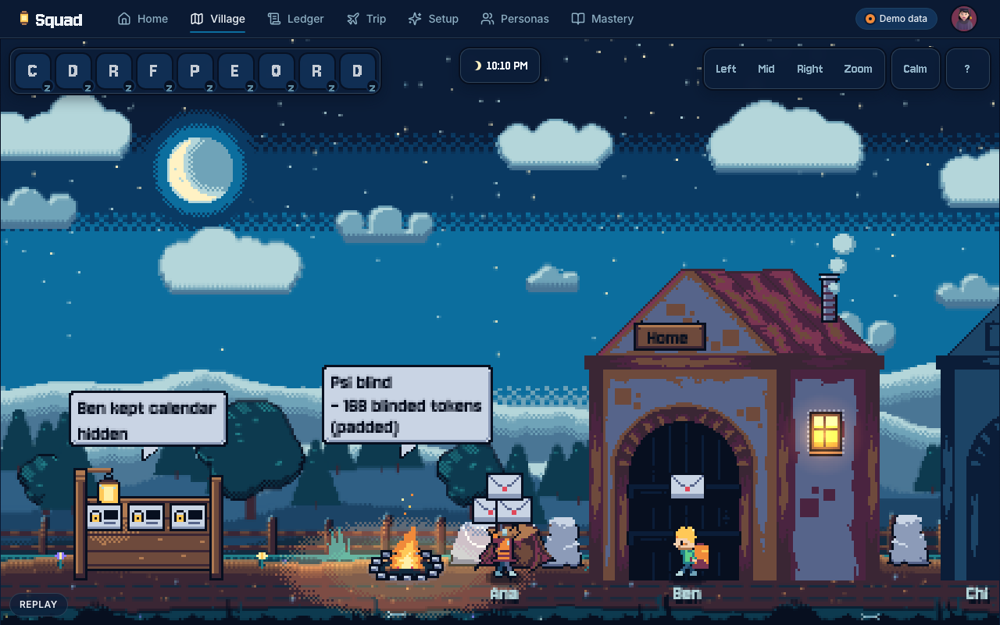
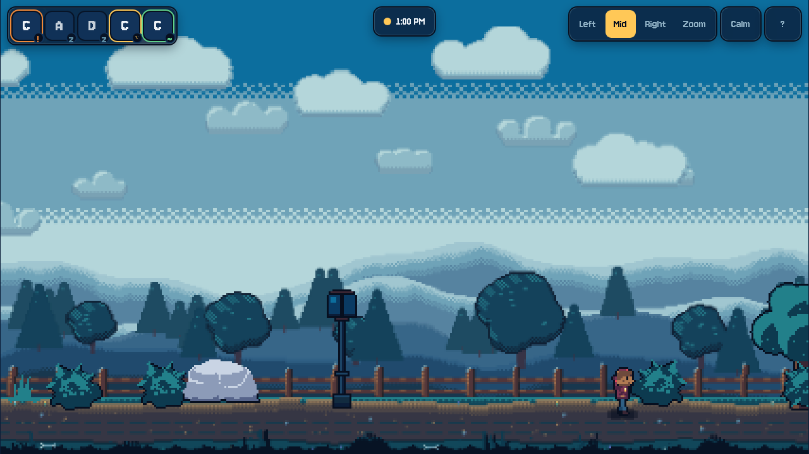
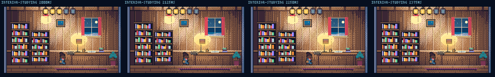
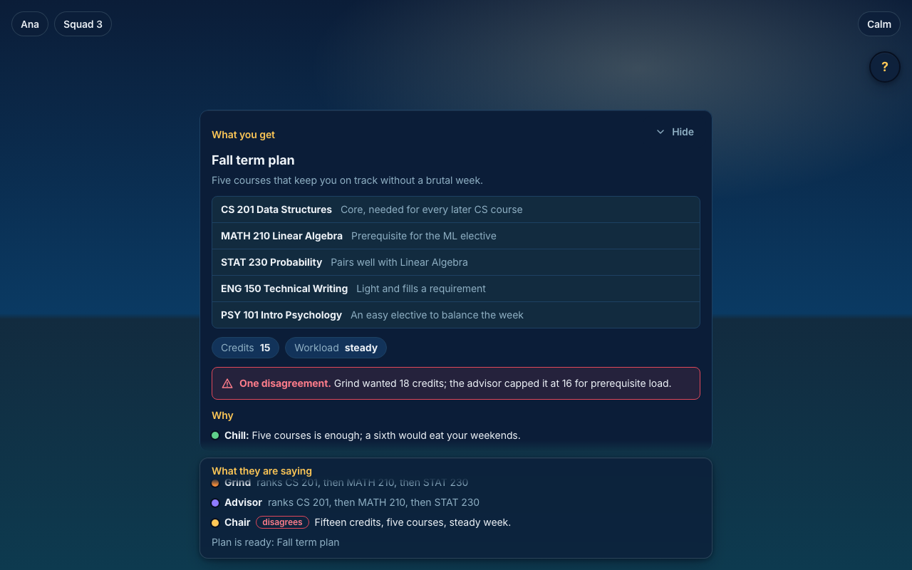
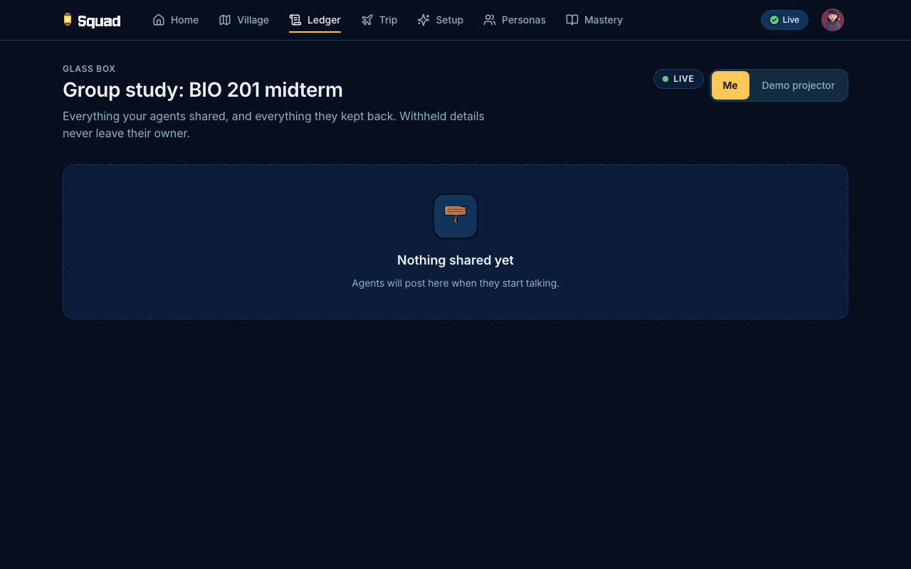
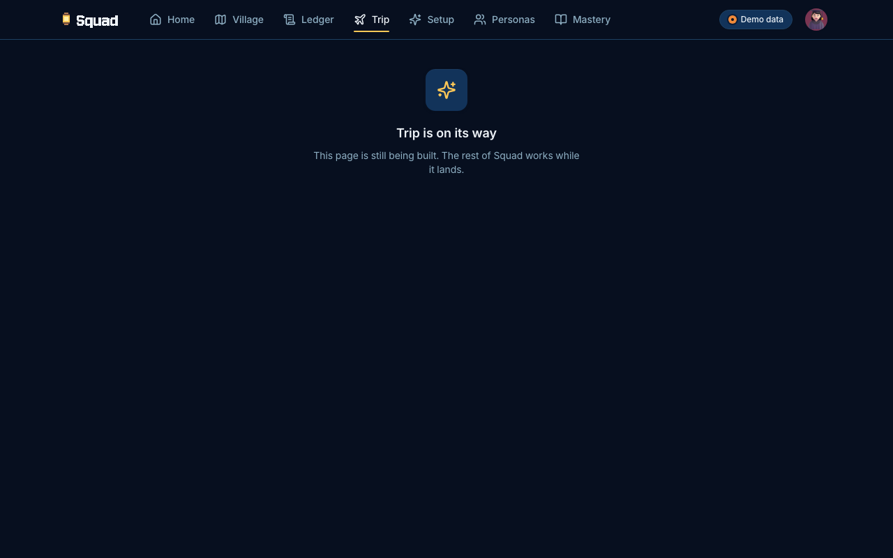
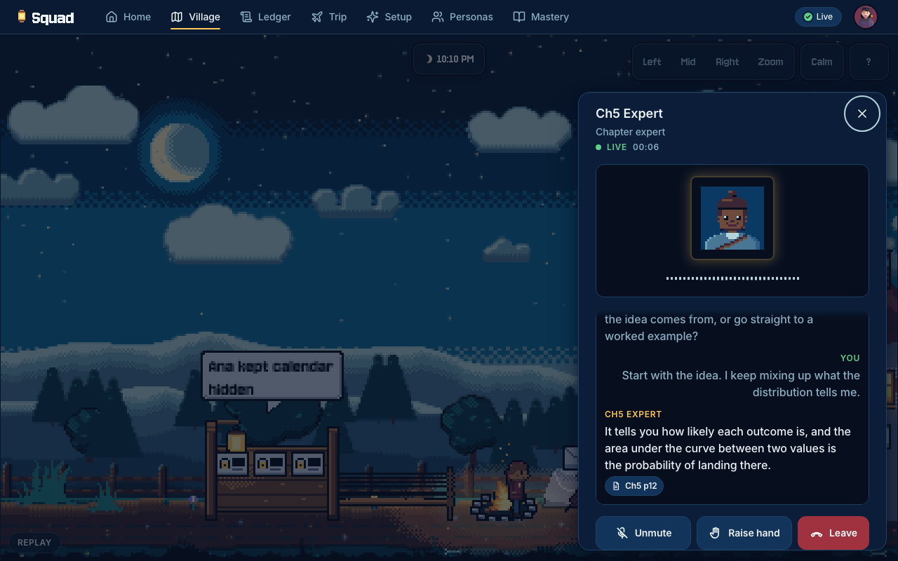
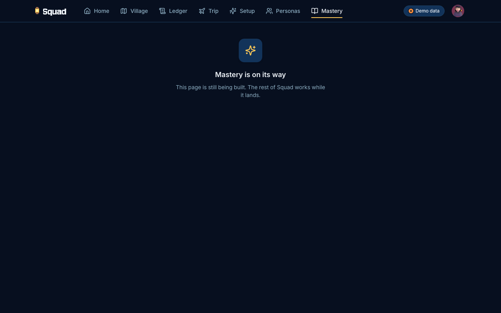
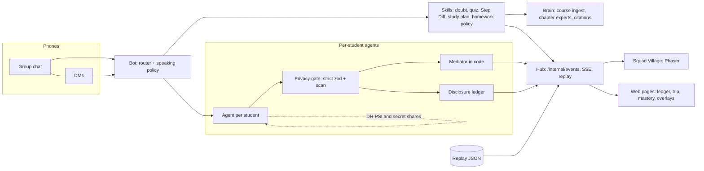

# Squad

[](https://github.com/vaibav03/squad/actions/workflows/ci.yml)


Squad puts a study group's agents where the group already talks. Type `@cubbie` in your group chat and get answers grounded in your own course files, with page citations. Each student also has a private agent that plans study sessions and trips with the others without ever showing a calendar, a budget or a DM. A walkable pixel village renders all of it live, so you can see who asked what, what was shared, and what was kept hidden.



## What Squad is

- A group-chat bot (`@cubbie`) with skills: grounded doubt answers, quizzes, Feynman practice, step-by-step solution diffs, study plans, podcasts and explainers.
- A mesh of per-student agents that coordinate through PSI (private set intersection) and secret sharing, so common free time and budget fit are computed without anyone's raw data leaving their agent.
- A village (Phaser) and a web app that only consume events from one hub. Thirteen rooms each have a purpose; a ledger shows every disclosure and every refusal.
- Entered in Track 3 (group chat) and Track 2 (agents) of the Cubbie hackathon. One shared core runs both.

Who it is for: students in a study group (and the judges, teammates and builders reading this). A student does not need to read code: start at the [User guide](docs/guide/USER-GUIDE.md).

## Feature tour

### Campus and village

Walk the village. Doors lock when private data is involved; the campfire is the only shared place; the notice board is the ledger.



### Rooms

Thirteen rooms: four chapter houses, a Council Hall, Debate Stage, Round Table, Feynman Porch, Panic Line booth, Exam Oracle, Oral Exam Hut, Rubric Courthouse and Devil's TA. What each is for, how to trigger it and whether it works on `main` today: [docs/guide/ROOMS.md](docs/guide/ROOMS.md).



### Council

Three blind solvers and a chair check a quiz answer key or debate a plan. Opinions are shown in full, with dissent marked, and the verdict carries an outcome card.


### Planning

The Round Table's advisors (chill, grind, advisor, chair) produce a term plan from a sample course catalogue, with grounded prerequisite and credit checks and any disagreement stated.



### Private agents and the ledger

Every disclosure, and every refusal, lands in the ledger as a label. A withheld value is never stored; the ledger can only say `hidden`.



### Trip

Agents find common dates (PSI), count who cannot afford an option (secret shares), vote with a secret ballot, and nothing is booked without a tap.



### Calls

Call an expert agent from the village; captions are always shown, voice plays when an ElevenLabs key is set.



### Mastery

Quiz results feed a per-chapter mastery view (no points, streaks or leaderboards by design).



### Group chat, podcast and explainer

> Status: the group-chat web view (citations that open at the matching sentence, quiz and confirm cards, DM versus group) is on branch `chat/web`, lands in batch 2. The podcast and explainer skills (`podcast`, `picture it`) are on `main` (`apps/bot/src/skills/media.ts`); their screenshots arrive with the chat view. Details: [User guide](docs/guide/USER-GUIDE.md).

## 5-minute quickstart

Needs Node 20 or newer (`.nvmrc` pins 22) and pnpm 10 (`corepack enable`, or `npm i -g pnpm`). No API keys are required.

```sh
git clone https://github.com/vaibav03/squad.git && cd squad
pnpm install
cp .env.example .env     # demo mode needs no keys
pnpm dev:all             # hub, four student agents and the web host
```

| What                       | URL                                                           |
| -------------------------- | ------------------------------------------------------------- |
| Village                    | http://localhost:5180/squad/village                           |
| Web app (all pages)        | http://localhost:5180/                                        |
| Hub health                 | http://localhost:8788/health                                  |
| Hub status (demo or real?) | http://localhost:8788/v1/status                               |
| Scripted replay (offline)  | http://localhost:5180/squad/village?replay=track2 (or track3) |

`pnpm dev:all` stops everything on Ctrl-C. Flags: `--no-web`, `--no-agents`. Ports can be moved with `DEV_ALL_HUB_PORT` and `DEV_ALL_WEB_PORT`; the four agent ports (4101 to 4104) are fixed, so if the script says "ports already in use", stop the other process or pass `--no-agents`. `pnpm doctor` prints a key and tool report. Without a key the hub runs stub ports, labels it in the page ("Demo data") and in `/v1/status`.

Replay-only run (scripted events through the same village code path, with a visible Replay badge, no hub needed for the data):

```sh
pnpm demo:seed
pnpm demo:replay track2   # or: pnpm demo:replay track3 ; add --no-open to skip the browser
pnpm demo:preflight       # env, keys, replay validity, no withheld value in any script
```

More: [Track 3 walkthrough](docs/demo/track3/README.md), [Track 2 walkthrough](docs/demo/track2/README.md), [Judge Q&A](docs/demo/QA.md).

## Demo mode versus real keys

| Capability              | Demo mode (no keys)                                | Real keys                                                         |
| ----------------------- | -------------------------------------------------- | ----------------------------------------------------------------- |
| Bot, agents, experts    | Scripted `FakeLlm` stand-in, labeled "Demo"        | Gemini (`GEMINI_API_KEY`); needs billing credits in AI Studio     |
| Voices                  | Captions only (`tts: none`)                        | ElevenLabs (`ELEVENLABS_API_KEY`)                                 |
| Mesh crypto             | Real (PSI, secret sharing, gate, ledger)           | Real (never uses an LLM)                                          |
| Calendars, budgets      | Seeded fixtures (4 students)                       | Seeded fixtures (real import is a later ticket)                   |
| Hub internal secret     | Dev default `dev-internal-secret` under `dev:all`  | Set `INTERNAL_EVENTS_SECRET` in `.env`                            |

Ask the hub which mode it is in: `GET /v1/status` returns `llm` (`gemini` or `fake`), `tts` (`elevenlabs` or `none`), `demo` and, when it fell back, a `reason`:

| `reason`            | Meaning                                                    | Recovery                                                   |
| ------------------- | ---------------------------------------------------------- | ---------------------------------------------------------- |
| `no_key`            | No `GEMINI_API_KEY` set                                    | Add the key and restart                                    |
| `forced_fake`       | `FORCE_FAKE_LLM=1`                                         | Unset it                                                   |
| `credits_depleted`  | Gemini returned 402 (prepayment or credits depleted)       | Top up billing; the hub re-probes every 60 s, no restart   |
| `rate_limited`      | Gemini 429                                                 | Re-probes every 60 s                                       |
| `invalid_key`       | Gemini rejected the key (401)                              | Fix the key; re-probes every 10 minutes                    |

While in fallback, answers come from the scripted model and the village and web show a Demo notice. Details: [architecture, LLM layer](docs/architecture/OVERVIEW.md).

Live run with real keys: put `GEMINI_API_KEY`, `ELEVENLABS_API_KEY` and a real `INTERNAL_EVENTS_SECRET` in `.env`, run `pnpm dev:all`, and check `pnpm demo:preflight --live`. iMessage via `imessage-kit` runs on a Mac signed into a dedicated bot Apple ID; fallback is the simulated students in the web panel. Real-key smoke scripts need `SQUAD_LIVE=1` and use a tiny budget. Hosting: [docs/DEPLOY.md](docs/DEPLOY.md) (owned by the deploy lead; may not be on `main` yet).

## How it works



- Every emitter POSTs `VillageEvent`s to the hub (`/internal/events`). The village and web pages only consume events; they never invent behavior and never receive a withheld value.
- Live and Replay take the same path (`?replay=<name>` swaps the source), so the visuals are identical.
- The mediator is deterministic code. LLMs talk to their own student and explain results; they never negotiate and never see another student's raw data.
- Workspaces: `apps/{bot,agent,hub,web-host}`, `packages/{core,brain,mesh,media,village,web,interior}`. Full diagrams: [docs/architecture/OVERVIEW.md](docs/architecture/OVERVIEW.md).

## Privacy and trust

We call it "privacy-preserving" using PSI plus secure aggregation. It is not zero-knowledge. This table is copied from [packages/mesh/README.md](packages/mesh/README.md), the source of truth.

| Truly cryptographic (semi-honest model)                                                                                                 | Data minimization (you trust our code)                                                                     |
| --------------------------------------------------------------------------------------------------------------------------------------- | ---------------------------------------------------------------------------------------------------------- |
| Common free slots and dates: ECDH PSI on ristretto255 (`@noble/curves`), sets padded to a fixed size and shuffled                       | The privacy gate and its strict zod schemas (no free-text field exists on the wire)                        |
| Budget ("can't afford"), veto, ranked-vote (Borda) and weak-topic counts: additive secret sharing mod 2^127-1, only totals are revealed | Each agent truthfully computing its own bits from its own data                                             |
|                                                                                                                                         | The disclosure ledger (labels only; a withheld value is never stored) and the village events built from it |
|                                                                                                                                         | The deterministic mediator (it sees tokens, share sums and counts, never inputs)                           |
|                                                                                                                                         | Students' DMs, and the minimum group size rule (squads under 3 publish no counts)                          |

Limits we state: semi-honest only (an agent that lies about its own budget is not caught); the mediator colluding with an agent can test small slot spaces; intersection size is revealed to the mediator; with 2 parties a total reveals the other's input, so squads under 3 get no counts.

Rules enforced in code:

- No free-text field exists in agent-to-agent messages; unknown keys are rejected, and a scan blocks any send containing a private value.
- A friend's agent asking "what is Ana's budget?" gets `query.denied`; the attempt lands on the notice board as a blocked row naming no value.
- The village renders events. `ledger.entry.withheld` can only be the literal `hidden`.
- Nothing is booked or locked without a tap: confirms are DM prompts, shown in the village as a waiting-for-yes ring.
- The bot speaks in a group only when mentioned; anything personal goes to a DM; graded homework gets a hint and the syllabus policy, never the answer.
- Sentinel tests plant fake withheld values (`$180`, `therapy`) in private data and assert none appear in any event, replay or log. `pnpm demo:preflight` runs the same check on the replays.

## Documentation

| Doc                                                                | For                                                      |
| ------------------------------------------------------------------ | -------------------------------------------------------- |
| [User guide](docs/guide/USER-GUIDE.md)                             | Students: set up, skills and phrases, privacy, fixes     |
| [Rooms](docs/guide/ROOMS.md)                                       | The 13 rooms and their status                            |
| [Architecture](docs/architecture/OVERVIEW.md)                      | Diagrams: packages, events, privacy, LLM layer, stores   |
| [Hub API](docs/api/HUB-API.md)                                     | Endpoints (table generated from the code)                |
| [Submission story](docs/SUBMISSION-STORY.md)                       | Tracks 2 and 3 narrative, limits, real versus demo       |
| [Judge Q&A](docs/demo/QA.md)                                       | Short honest answers                                     |
| [Contributing](docs/CONTRIBUTING.md), [FAQ](docs/FAQ.md)          | Worktrees, commits, tests, adding a skill, room or event |
| [Credits](docs/CREDITS.md)                                         | Art, fonts, dependencies, course material                |
| Specs: [docs/specs/00-OVERVIEW.md](docs/specs/00-OVERVIEW.md)      | Contracts and design; decisions in `docs/DECISIONS.md`   |
| [Branch tracker](docs/tracking/README.md), [QA](docs/qa/ROOMS-AUDIT.md) | Other leads' docs                                   |

## Troubleshooting

- `dev:all` says ports already in use: another stack is running; see the quickstart note above.
- `demo:replay` says the hub is not healthy: check `HUB_BASE_URL` (default `http://localhost:8788`) and that the port is free; run `pnpm --filter @squad/hub start` and read its log.
- Blank village: Phaser loads only on the village route; hard reload `/squad/village`.
- Answers look scripted: check `/v1/status`; see the reason table above.
- Preflight warns about missing keys: expected without keys; it fails only with `--live` or `SQUAD_LIVE=1`.
- Node too old: use Node 20 or newer.

## Limits and what is next

- Calendars, budgets and the students in the demo are seeded fixtures; real Google `freeBusy` import is a later ticket. Replay uses scripted events, labeled as such on screen.
- Security model is semi-honest; there is no range proof over a committed budget.
- iMessage via `imessage-kit` is a prototype transport; production would use Apple Messages for Business or a messaging API.
- Measured cost per question: not yet measured. We publish a number only once we measure it.
- Next: single-player Cubbie becomes multiplayer on this core; integration into the Nook clone mounts `@squad/web` under `/squad/*`.

## Credits

Course material: Introductory Statistics 2e, Barbara Illowsky, Susan Dean and OpenStax contributors, OpenStax, Rice University, CC BY 4.0 (https://creativecommons.org/licenses/by/4.0/), free at https://openstax.org/details/books/introductory-statistics-2e. We extracted page ranges of four chapters unchanged; no endorsement by OpenStax or Rice University is implied.

Art: CC0 packs by Pixel-boy and AAA, Kenney, Luis Zuno (ansimuz) and OpenGameArt contributors; Autumn Town by Nirva; Microsoft Fluent Emoji (MIT); Lucide (ISC); fonts Inter, Jersey 10 and Silkscreen (OFL 1.1). Modern Interiors by LimeZu is licensed to the repo owner and is not redistributed here. Every pack, license and credit line: [docs/CREDITS.md](docs/CREDITS.md). No Cubbie assets or branding are used.

## Dev guide

```sh
pnpm install            # install all workspaces
pnpm check              # typecheck + lint (eslint + prettier --check) + unit tests; CI runs this
pnpm test:smoke <ws>    # one workstream's smoke tests (bot|agent|hub|web-host|core|brain|mesh|media|village|web|all)
pnpm format             # prettier --write
pnpm dev                # each app's own `dev` script (use pnpm dev:all for the whole stack)
pnpm bot:chat           # talk to @cubbie in the terminal (CLI transport)
```

`@squad/core` is the shared contract package (`VillageEvent` zod schema, replay schema, `postEvent`, `Llm` and `FakeLlm`, sentinel test util); contract changes go only through `packages/core`. Workflow and commit rules: [docs/CONTRIBUTING.md](docs/CONTRIBUTING.md).
