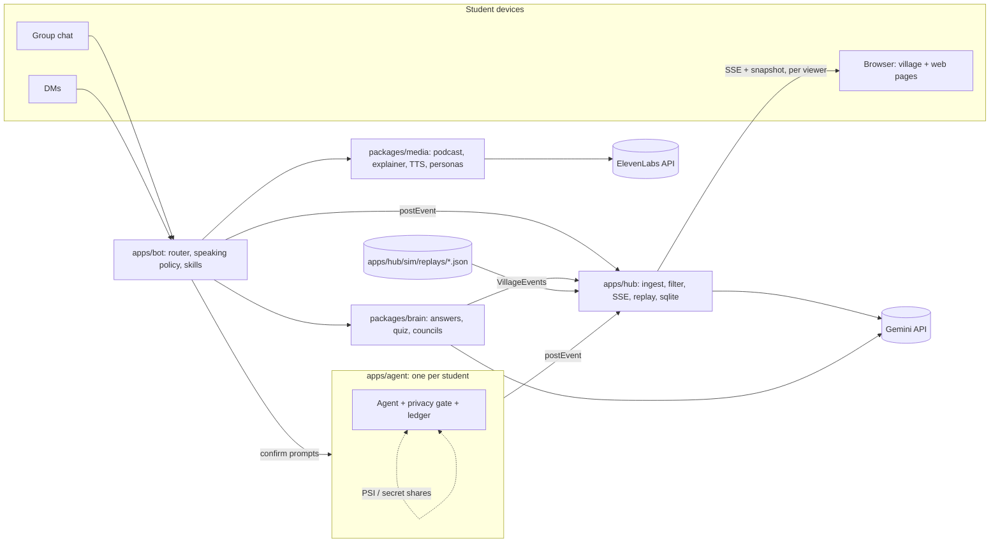
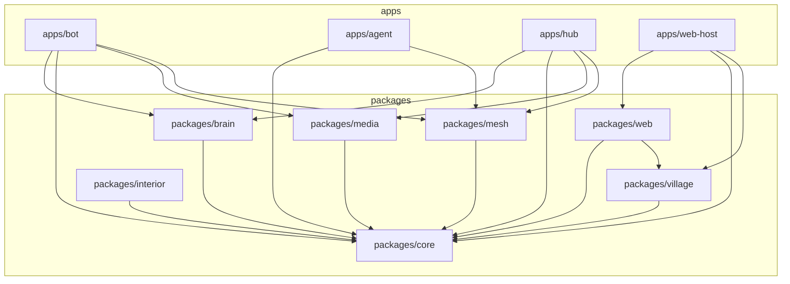
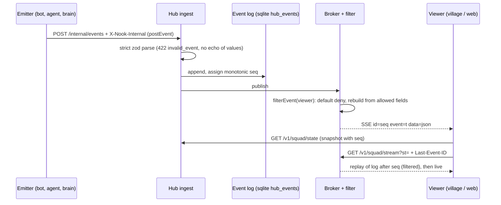
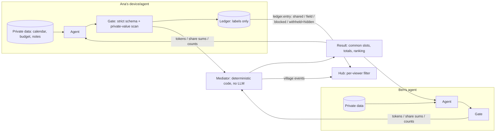
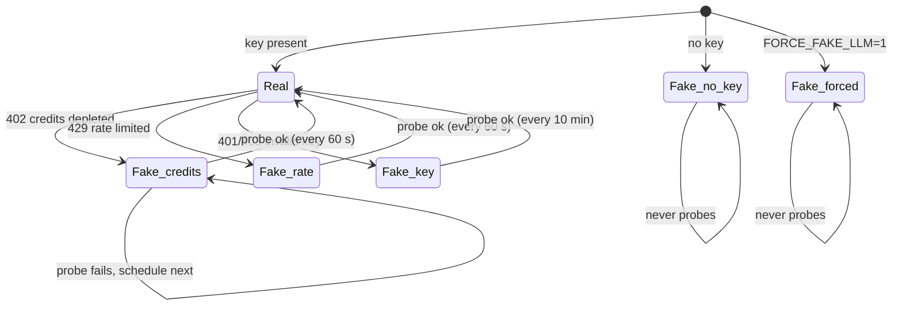
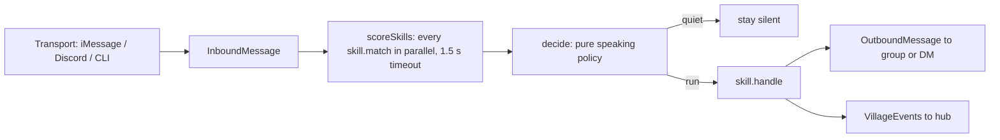

# Architecture overview

How Squad fits together, written from the code on `main`. Every diagram below names real packages, files and routes. For the endpoint list see [../api/HUB-API.md](../api/HUB-API.md); for the privacy crypto see `packages/mesh/README.md` and `docs/mesh-api.md`; for the specs behind it see `docs/specs/00-OVERVIEW.md`.

Contents: [System context](#1-system-context), [Package map](#2-package-map), [Event flow](#3-event-flow), [Privacy architecture](#4-privacy-architecture), [LLM layer](#5-llm-layer), [Chat, router and skills](#6-chat-router-and-skills), [Data stores](#7-data-stores), [Trust table](#8-trust-table).

## 1. System context

External services: Gemini (LLM) and ElevenLabs (voices). Both are optional: without keys the system runs on a scripted fake model and no audio (see [LLM layer](#5-llm-layer)). Transports for the bot are iMessage (`imessage-kit`), Discord and a CLI (`apps/bot/src/transports`).

## 2. Package map

Arrows are the `@squad/*` entries in each `package.json` `dependencies`.

| Workspace | Responsibility |
|---|---|
| `packages/core` | The contract: `VillageEvent` zod union, replay schema, `postEvent`, `Llm` interface, `FakeLlm`, `GeminiLlm`, `createResilientLlm`, sqlite helper, config loader, sentinel test util. `@squad/core` is browser-safe; `@squad/core/node` adds sqlite, config and Gemini. |
| `packages/brain` | Course ingest (PDF to chapters), grounded answers with citation checks, quiz, Feynman, step diff, study plan, course plan, mastery, councils (`councils/*`). |
| `packages/mesh` | Privacy-preserving coordination: strict protocol schemas, gate, ledger, ECDH PSI, additive secret sharing, deterministic mediator, study and trip flows, scripted run. |
| `packages/media` | Personas, voices and TTS (ElevenLabs), podcast, explainer, call sessions, sprites and portraits. |
| `packages/village` | Phaser village renderer, camera director, scenes, motion, event sources (live and replay). Consumes events only. |
| `packages/web` | React pages and primitives (ledger, trip, mastery, council, chat overlays, gallery). |
| `packages/interior` | Top-down interior campus engine (tilemap, navigation, world, agents). It depends only on core and is not yet imported by another workspace. |
| `apps/bot` | Chat transports, router, speaking policy, skill registry. |
| `apps/agent` | One process per student: private data, mesh participant, confirm cards. |
| `apps/hub` | Hono server: auth, `/internal/events` ingest, per-viewer filter, SSE, snapshot, replay, quiz, calls (websocket), trips, ledger, sqlite. |
| `apps/web-host` | Vite host that mounts `@squad/web` and the village (port 5180). |

## 3. Event flow

The `VillageEvent` contract lives only in `packages/core/src/events.ts` (strict zod, discriminated on `t`). The 16 types are: `agent.state`, `agent.message`, `ledger.entry`, `confirm.pending`, `confirm.done`, `council.opinion`, `council.rank`, `council.verdict`, `quiz.question`, `quiz.answer`, `quiz.result`, `call.start`, `call.caption`, `call.end`, `trip.confirmed`, `mastery.changed`. The hub also carries `x.*` extension envelopes (private ledger rows, trip updates, ingest progress; see HUB-API section 6).

- **Hub filtering** (`apps/hub/src/filter.ts`): one function used for stream, snapshot, ledger, trips and replay. Default deny; events are rebuilt from allowed fields so an unexpected key cannot pass. Examples: `confirm.*` and `mastery.changed` only reach the student they name; `quiz.*` `correct` is stripped unless the squad enabled reveal; `call.caption` only reaches the student on the call.
- **Late joiners and resume:** the snapshot carries `seq`; the stream replays everything after `Last-Event-ID`. If the id is older than the retained buffer (5000) the hub sends `x.resync` and the client refetches.
- **Replay:** `apps/hub/sim/replays/*.json` are `ReplayScript`s (`packages/core/src/replay.ts`: `name`, `version: 1`, `loop`, `cast.me`, ordered `events`, `checkpoints`). `GET /v1/squad/replay/:name` returns the script filtered as `cast.me` with the same filter as live; the client plays it through a `ReplaySource` so Live and Replay take the same code path in the village.

## 4. Privacy architecture

What each party sees:

| Party | Sees | Never sees |
|---|---|---|
| A student's own agent | Their own data; the mediator's result | Other students' raw data |
| Another student's agent | Tokens (PSI) and share sums for the protocol; `query.denied` if it asks for a value | Your budget, calendar items, notes |
| Mediator (code) | Hashed tokens, share sums, counts | Any input value |
| Hub and village | Public events and ledger labels; `withheld` is the literal `hidden` | Any withheld value (not in the event schema) |
| The owner (via `GET /v1/ledger/:taskId`) | Their own raw rows (unless projector mode) | Others' raw rows |

Mechanisms: free-time overlap uses ECDH PSI on ristretto255; budget, veto, ranked-vote and weak-topic counts use additive secret sharing mod 2^127-1 so only totals are revealed. The gate (`packages/mesh/src/gate`) validates every outbound message against a strict schema with no free-text field, then scans for the agent's private values; a blocked send writes a `blocked` ledger row. Squads under 3 members get no counts, averages or vote tallies (`packages/core/src/group-size.ts`, enforced again in the hub). Nothing is booked without a student tap: confirms are prompts that wait for a yes.

## 5. LLM layer

`Llm` (`packages/core/src/llm/types.ts`) has `complete`, `json` (schema-validated) and `createCache`. Three model tiers pick the model per call: `fast`, `main`, `chair`. Defaults in `packages/core/src/llm/gemini.ts`, overridable by `GEMINI_MODEL_FAST`, `GEMINI_MODEL_MAIN`, `GEMINI_MODEL_CHAIR`:

| Tier | Default model | Used for |
|---|---|---|
| `fast` | `gemini-3.5-flash-lite` | cheap calls and the recovery probe |
| `main` | `gemini-3.8-flash` | the default when a call names no tier |
| `chair` | `gemini-3.8-flash` | the tier requested by council chairs |

`GeminiLlm` retries a 429 a bounded number of times, honoring the server `retryDelay` up to a cap. `classifyGeminiError` (`errors.ts`) maps provider errors to `credits_depleted` (HTTP 402, or a 429 mentioning credits/billing), `rate_limited` (429 / RESOURCE_EXHAUSTED), `auth` (401/403, invalid key) or `other`. `createResilientLlm` (`resilient.ts`) wraps the real model and a `FakeLlm`:

While on the fake, the failed request itself is answered from the fake, so the student never sees an error. Probes are one 1-token `fast` call, never on the caller's path, triggered by traffic and by `status()`. Other errors surface unchanged. `GET /v1/status` exposes `llm`, `tts`, `reason`, `since`, `lastProbeAt`, `nextProbeAt` and a notice, so the UI can show a Demo badge and why. The bot and agent build the same wrapper (`apps/bot/src/main.ts`, `apps/agent/src/main.ts`); the hub does in `apps/hub/src/wire.ts`.

## 6. Chat, router and skills

Policy (`apps/bot/src/policy.ts`, pure): in a DM, always run the best skill; in a group, run when the bot is mentioned, or when the best score is at least 0.8 and no unprompted message was sent in the last 120 s; otherwise stay quiet. Ties go to the earliest registered skill. Each chat is decided serially; skill execution is not. Event publishing is fire-and-forget so a slow hub never delays a reply.

Skills (`apps/bot/src/skills/index.ts` `createSkills`, order is tie-break priority): chat; brain answers (`doubt`, `behind`, `hwpolicy`); `quiz`; `feynman`; `stepDiff`; `studyPlan`; `coursePlan`; and, when TTS is available, `podcast` and `explainer` (`skills/media.ts`). Mesh flows (trip, study scheduling) run through the agents and hub, not as chat skills. Exact phrases are in the [user guide](../guide/USER-GUIDE.md).

## 7. Data stores

All stores are sqlite via `better-sqlite3` (`openDb` in `packages/core/src/db.ts`).

| Store | File | Tables | Holds |
|---|---|---|---|
| Hub | `DB_PATH` (default `data/squad.db`) | `hub_events`, `hub_meta`, `hub_students`, `hub_squads`, `hub_squad_settings`, `hub_trips`, `hub_ledger_rows`, `hub_ledger_private`, `hub_busy_blocks`, `hub_confirmed_tasks` | Event log (replay source, 5000-event buffer served), directory, trips, ledger rows (labels), owner-only private ledger values, busy blocks, one-shot trip confirmations. Agent state and pending confirms are rebuilt from the log at start. |
| Core / bot | shared `Db` (core schema) | `students`, `chats`, `chat_members`, `messages`, `memory`, `pending_confirms` | Chat history with the routing decision per message, bot memory, confirm prompts. |
| Brain | brain store (course, chapters, quiz, mastery tables) | see `packages/brain/src` | Ingested course chunks, quiz state, mastery. |
| Agent | `data/agent-<id>.sqlite` | agent-local | One student's private data stays in that student's file. |

`hub_ledger_private` is the only place raw withheld values live in the hub, and it is never streamed.

## 8. Trust table

Copied verbatim from `packages/mesh/README.md` (state this in the pitch).

We call this **privacy-preserving**, built from **PSI + secure aggregation**. It is not zero-knowledge: nothing here is a proof.

| Truly cryptographic (semi-honest model)                                                                                                 | Data minimization (you trust our code)                                                                     |
| --------------------------------------------------------------------------------------------------------------------------------------- | ---------------------------------------------------------------------------------------------------------- |
| Common free slots and dates: ECDH PSI on ristretto255 (`@noble/curves`), sets padded to a fixed size and shuffled                       | The privacy gate and its strict zod schemas (no free-text field exists on the wire)                        |
| Budget ("can't afford"), veto, ranked-vote (Borda) and weak-topic counts: additive secret sharing mod 2^127-1, only totals are revealed | Each agent truthfully computing its own bits from its own data                                             |
|                                                                                                                                         | The disclosure ledger (labels only; a withheld value is never stored) and the village events built from it |
|                                                                                                                                         | The deterministic mediator (it sees tokens, share sums and counts, never inputs)                           |
|                                                                                                                                         | Students' DMs, and the minimum group size rule (squads under 3 publish no counts)                          |

### Limits we state

- Semi-honest only. An agent that lies about its own budget or veto is not caught (a range proof needs a committed, attested budget, which we do not have).
- The mediator colluding with an agent can test small slot spaces (dictionary attack on tokens); the PSI intersection size is revealed to the mediator.
- With 2 parties a total reveals the other party's input to each of them; that is why squads under 3 get no counts.
- The gate scan is a safety net, not a proof: it catches an honest-but-buggy flow from sending a private value. The real guarantee is the schema: there is no field a private string can fit into.
- Message ordering / replay protection is per gate instance (in memory).
