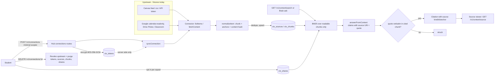

# Context store (Canvas / Google Workspace ingestion foundation)

Status: foundation built against **fake connectors and synthetic fixtures**. No real Google or Canvas credential exists
yet, so every connection is labelled `mode: "fixture"` and the UI must say so. Nothing in this document implies a live
integration. The Google OAuth consent flow UI is intentionally not built.

Code map:

| Area | Where |
|---|---|
| Source kinds, `source://` URIs, citation `source` field | `packages/core/src/context.ts` (additive; `Citation` and `ChatCitation` gain an optional `source`) |
| Store, chunking, normalizer, sync, search, retrieval tool | `packages/brain/src/context/*` |
| Cross-kind citation verifier and renderer | `packages/brain/src/citations/sources.ts` |
| Connector interfaces, fakes, fixtures | `packages/brain/src/context/connectors/*`, `packages/brain/fixtures/connectors/*` |
| Hub service, encrypted token store | `apps/hub/src/context/{service,tokens}.ts` |
| Hub routes | `apps/hub/src/routes/connections.ts` (registered by one line in `app.ts`) |
| Source viewer | `packages/web/src/components/source-viewer/*` (`ExternalExcerpt.tsx`) |

## Data flow



## Model

`ContextConnection` (per owner and provider): `id`, `provider` (`canvas|google`), `mode` (`fixture|live`), `variant`
(`feed|token|oauth`), `accountHash` (HMAC of the external account id, never the raw id), `scopes`, `status`
(`live|expired|revoked|error`), `degraded`, `lastSyncAt`, `expiresAt`.

`ContextSource`: stable `id` (`src_` + hash of owner, provider and external id), `kind`
(`pdf|canvas_file|canvas_assignment|canvas_event|gdoc|gdrive_file|gcal_event|classroom_item`), `uri`
(`source://<kind>/<id>`), `url` (deep link into Canvas/Drive/Calendar), `title`, `courseId`, origin timestamps
(`modifiedAt`, `dueAt`, `startsAt`, `endsAt`), `contentHash`, `fetchedAt`, `expiresAt` (retention, default 180 days),
`visibility` (`private` default, `squad` only by explicit opt-in), `sharedWith` squads, `provenance`
(`canvas:fixture`), `syncVersion`.

`ContextChunk`: `anchor` (`s1` section chunk, `p3` or `p3.2` page chunk), `page`, `section`, `text`.

Rules enforced in code: ids are stable across re-syncs; identical file content arriving by two routes for one owner is
stored once; an upstream deletion deletes the derived copy and leaves only a tombstone (id, owner, reason) so the owner
sees "removed/revoked" while everyone else sees "not found"; revoke deletes every derived row for the connection.

## Citations

Two forms, both verified-quote only:

* PDF (unchanged): `[file p.N]`, claims checked by `verifyClaims`.
* Any other source: `source://<kind>/<id>#<anchor>` (marker form `[source://...]`), claims checked by
  `verifySourceClaims`: the source and anchor must exist among the retrieved chunks and the quote must appear verbatim
  (same normalisation as PDFs) in that chunk. Anything else is struck and the answer falls back to "Not in the materials".

`Citation.source = { kind, id, anchor?, title?, url? }`; for non-PDF citations `file` carries the display title and
`chapter` is `context`. The web `SourceCitation` has the same optional `source` and the chip label is the title.

## Retrieval tool contract for agents

```ts
type RetrieveContext = (query: string, courseId?: string) => Promise<RetrievedChunk[]>;
// brain: createRetrieveContext(store, viewer, { limit? })  -> RetrieveContext bound to ONE viewer
interface RetrievedChunk {
  chunkId; sourceId; kind; title; courseId; anchor; page; section; text; score; url;
  shared: boolean;                 // true when another student shared it with the viewer's squad
  citation: Citation;              // citation.quote is a verbatim sentence of `text`; citation.source is set
}
```

The viewer is fixed at construction (`{ studentId, squadIds }`, memberships verified by the caller), so a live-council
agent cannot request someone else's private chunks. Visibility is decided in SQL before any text is loaded. Live agents
call it through the hub (`GET /v1/context/search`) or in process via the store on `hub.deps.context`.

Brain wiring: `assembleBrain({ context: store })` and `brain.ask(courseId, question, { viewer, contextCourseId? })`.
With a viewer, readable chunks are retrieved, the model returns claims with a source URI and quote, claims are verified
verbatim, and the context answer is appended to (or replaces an ungrounded) PDF answer. Without `viewer` the behaviour
is exactly as before. `contextCourseId: null` searches every course the viewer can read (there is no mapping between a
Squad library course and a Canvas course yet). The hub voice-call answer path passes the viewer; the chat path owned by
another workstream does not yet (see gaps).

## Hub API (all under bearer or session auth)

| Method and path | Purpose |
|---|---|
| `POST /v1/connections` | Connect. Body: `{ provider, variant?, scopes[], feedUrl? \| token?+baseUrl?, pickedFileIds?, mode? }`. Scopes must be exactly the minimal allowed set. `mode:"live"` returns 501 `live_not_available`. Returns the connection view and the first sync report (201). 409 if the same account is already connected. |
| `GET /v1/connections` | List the caller's connections: `mode`, `modeLabel`, `status`, `statusLabel`, `degraded`, `scopes`, `lastSyncAt`, `expiresAt`, `canSync`, source counts, squads shared with. Runs the refresh/expiry check first. Top level carries `mode` and `allowedScopes`. |
| `GET /v1/connections/:id/sources` | Metadata of imported sources (for the sharing picker). |
| `POST /v1/connections/:id/sync` | Sync now. 409 `connection_expired` / `connection_revoked`; a 401 from upstream returns the degraded view. |
| `POST /v1/connections/:id/share` | `{ squadId, sourceIds? , all?, shared }` per-squad opt-in or opt-out. `all` skips calendar-kind sources (events must be listed explicitly). Caller must belong to the squad. |
| `DELETE /v1/connections/:id` | Revoke upstream (best effort), delete the token row, delete all sources, chunks and shares; the connection stays listed as `revoked`. `?remove=1` on a revoked connection drops the row. |
| `GET /v1/context/search?q=&courseId=&kind=&limit=` | Grounded chunks with citations from the viewer's own and squad-shared sources only. |
| `GET /v1/context/source?id=&kind=&anchor=&quote=` | Source viewer excerpt (below). Others' private sources answer 404 `not_found`. |

Source viewer contract (`ExternalSourceExcerpt`): `{ ok:true, sourceKind, sourceId, title, courseId, anchor, section,
lines[{n,text,hit}], quote, quoteVerified, externalUrl, provider, provenance:"fixture"|"live", fetchedAt, shared }` or
`{ ok:false, reason:"removed"|"revoked"|"page_missing"|"not_found" }`. The viewer shows an "Open in Canvas/Drive/Calendar/
Classroom" link (https only; "(demo link)" in fixture mode), a "Demo data, not a real account" badge for fixtures and a
dedicated "Access to this source was revoked" state.

## Token handling

* Tokens, feed URLs (a bearer secret) and refresh tokens live only in `ctx_tokens`, encrypted with AES-256-GCM, a fresh
  IV per write and the connection id as AAD (a copied row will not decrypt under another id).
* Key: `CONTEXT_TOKEN_KEY` (32 bytes, 64 hex chars or base64). Outside production a key is derived from the session secret
  so fixture mode works locally; in production a missing key makes connect return 503 `token_store_unconfigured`.
* Responses carry no token, feed URL, account id or hash. Logs record connection id, provider, scopes, outcome and counts
  only; the shared logger also redacts token-shaped keys. Tests scan every response, log line and plaintext table for
  sentinel secrets.
* Refresh: before each sync or listing, a Google grant within 60 s of `expiresAt` calls `connector.refresh`. Success
  stores the new access token and moves `expiresAt` to the real expiry (a short-lived token is never stretched). A 401 on
  sync refreshes once and retries (`syncConnection` `onRefreshed` persists the new token). A refresh the provider
  refuses with `invalid_grant` sets `status: revoked`, purges the imported data and says "Google access was revoked.
  Imported data was removed. Reconnect to import again." (`needsReconnect: true`). Any other refusal sets
  `status: expired`: data kept, sync stops (409 `connection_expired`), `stale: true` on the view and on every
  `/v1/context/search` hit of that connection, Reconnect prompt. Never left `live`.
* Upstream 403 sets `status: error`, `degraded: true` with the
  label "Degraded: the provider rejected the credential; showing the last imported data" and keeps imported data.
* Canvas feed and API-token URLs must be https, non-IP, non-localhost, no embedded credentials (SSRF guard for the real
  connector).
* In fixture mode a pasted token is stored encrypted but never sent anywhere.

## Scopes (minimal, read-only)

| Provider | Scope | Gives | Notes |
|---|---|---|---|
| Google | `https://www.googleapis.com/auth/calendar.readonly` | `gcal_event` | Events default to private; never bulk-shared. |
| Google | `https://www.googleapis.com/auth/drive.file` | `gdoc`, `gdrive_file` | Per-file via Google Picker only; not `drive.readonly`. The fake only returns picked files. |
| Google | `https://www.googleapis.com/auth/classroom.courses.readonly` | course list | |
| Google | `https://www.googleapis.com/auth/classroom.coursework.me.readonly` | `classroom_item` | The student's own coursework, no grades. |
| Canvas | `canvas.calendar_feed` (the per-user `.ics` feed URL) | `canvas_event`, due dates | No OAuth, no institution approval. URL is a bearer secret. |
| Canvas | `canvas.api_token.read` (student-generated token, optional) | `canvas_assignment`, `canvas_file`, announcements | Many institutions disable student tokens. Grades are never requested. |

Anything else (Drive full access, Gmail, calendar write) is rejected with 400 `scope_not_allowed`.

## What a real registration needs (BLOCKED)

* BLOCKED: Google Cloud project with an OAuth 2.0 Web client, consent screen, authorised redirect URI on the hub, test
  users while unverified. Sensitive scopes (`calendar.readonly`, `drive.file`, Classroom) need Google verification
  (privacy policy URL, homepage, scope justification, demo video) before general use. No client id exists.
* BLOCKED: Google Picker needs a browser API key and the web UI to launch it, plus passing selected file ids to
  `POST /v1/connections`.
* BLOCKED: the OAuth consent flow UI and callback route (explicitly not built).
* BLOCKED: real connector implementations (HTTP clients for Canvas REST, Calendar, Drive, Classroom) behind the existing
  `Connector` interface, including SSRF-safe fetch for the feed URL, pagination, rate limits and incremental sync.
* BLOCKED: Canvas API access depends on each institution allowing student tokens, or an admin-issued developer key /
  LTI 1.3 registration (not feasible for the hackathon).
* BLOCKED: file text extraction for real Drive/Canvas binaries (docx/pptx); only text and page-structured fixtures are
  handled.
* Needs a decision: `CONTEXT_TOKEN_KEY` provisioning and rotation in deployment, and a retention period policy.

## Honest-labelling rules for the UI

`GET /v1/connections` reports `mode: "fixture"` and per-connection `modeLabel`. A UI must show that label, never a
"Connected to Canvas" claim for a fixture connection, and must render `statusLabel` for expired, degraded and revoked
states.

## Known gaps

* No mapping between Squad library courses and Canvas/Google courses; `brain.ask` can search all of the viewer's courses
  via `contextCourseId: null`.
* The web chat doubt path (bot skills, `hub-chat`) is owned by another workstream and does not pass `viewer` to
  `brain.ask` yet; only the voice-call answer path does.
* `LiveCitationSchema` and `CouncilCitationSchema` are strict and do not carry `source`; only `Citation` and
  `ChatCitation` do.
* Search is BM25 over chunks (same family as the Dean); no embeddings.
* No scheduled re-sync or retention job is wired (`store.purgeExpired(now)` exists); pickedFileIds are fixed at connect.
* No web UI for connecting or for the sharing picker; only the source viewer.

## Tests

* `packages/brain/src/context/context.test.ts`: chunking, ids, account hashing, sync (add, update, unchanged, delete,
  dedupe, feed variant), expiry, 401 degrade, revoke purge, Google scope behaviour, citations across kinds, isolation,
  retention, and `Brain.ask` citing a Canvas assignment (and striking a fabricated quote).
* `apps/hub/src/routes/connections.test.ts`: connect, sync, search, citation, source viewer contract, privacy isolation,
  sharing opt-in and opt-out, revoke and purge, upstream revoke, expired and refresh, degraded, token store, and the
  sentinel scan of responses, logs and database.
* `packages/web/src/components/source-viewer/source-viewer.test.tsx`: non-PDF rendering, external link, demo badge,
  revoked state, chip and host.
