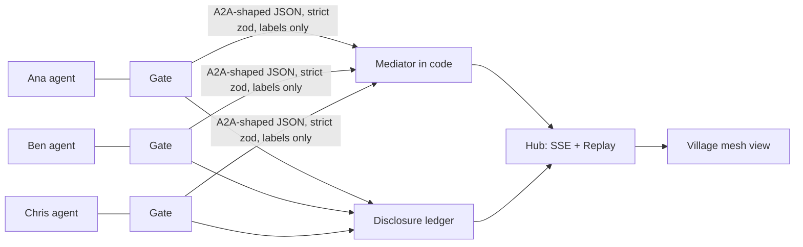

# Track 2: Three Cubbies, one plan, zero oversharing

Each student gets a Cubbie agent that plans study sessions and trips with friends, shares only what it must, and asks you before it commits.

Capture to add: `docs/demo/media/track2.gif` (20-second loop of the campfire negotiation to the trip cutscene).

## The problem, in a student's words

"Planning anything with friends means either sharing my whole calendar or sending fifty texts. And I do not want my friends to know I can't afford Cabo."

## Demo walkthrough (about 2 minutes, Replay `track2`, 108.5 s)

Cast: Ana (presenter), Ben, Chris. Squad `sq_demo`. Every beat is tied to a judging criterion.

| # | Beat | What the village shows | Criterion |
| - | ---- | ---------------------- | --------- |
| 1 | Hook | Three agents idle behind locked doors | Use case: "we need this" |
| 2 | Campfire negotiation (checkpoint `campfire`) | Agents walk out to the campfire; bubbles carry only labels like "168 blinded tokens (padded)" | Technical depth: DH-PSI |
| 3 | Conflict (`conflict`) | "0 common slots", red "!" with "no slot works for everyone", mediator proposes a counter-offer | Conflicting constraints |
| 4 | Waiting for yes (`waiting-for-yes`) | Ben's agent stops with a waiting ring; his phone asks "Move gym to make Wed 7 PM work?"; ring clears on yes | When agents ask to confirm |
| 5 | Notice board (`notice-board`) | Ledger rows: shared "busy 3", withheld "hidden" | What they share |
| 6 | Attack (`attack`) | Ben asks his agent for Ana's budget; mediator shows `query_denied`; a blocked "nothing" row for budget lands on the board | Technical depth: gate; what they share |
| 7 | Trip planner (`trip`) | Dates by PSI, budgets and vetoes by secret shares; "option dropped: budget", "dropped: veto"; three waiting rings; two yes, one not yet (`before-last-confirm`), then the last yes fires `trip.confirmed` and the trip cutscene plays | Confirm before commit; craft |

Notes on honesty: the Replay is a scripted `VillageEvent` stream through the same code path as Live and the village shows a Replay badge. The hub filters the Replay as Ana, so Ben's and Chris's DM prompts do not appear on her screen, only the rings above their doors. Dollar caps appear nowhere in any event.

## How it works



- Free slots and dates: ring DH-PSI on ristretto255, sets padded to a fixed size and shuffled so nobody learns how busy you are.
- Budgets, vetoes, votes, soft costs, topic counts: additive secret sharing mod 2^127 - 1; only the total is revealed.
- The mediator is deterministic code: pick the lowest soft cost, drop options with any "cannot afford" or veto, rank survivors by secret Borda, then ask each student by DM.
- Nothing is booked without every yes. `trip.confirmed` is emitted once.

## Privacy and consent rules

| Truly cryptographic (semi-honest model) | Data minimization (trust our code) |
| --------------------------------------- | ---------------------------------- |
| Common free slots and dates (DH-PSI) | The privacy gate and its strict zod schemas |
| Budget, veto, vote and topic counts (secret sharing) | Each agent truthfully computing its own bits |
| | Students' DMs and the ledger itself |

We say "PSI + secure aggregation", never "zero-knowledge". Limits: semi-honest only, a colluding coordinator can probe small slot spaces, intersection size is revealed, per-task query budget (default 8). Squads under 3 hide counts.

## Run it

```sh
pnpm install && cp .env.example .env
pnpm demo:seed
pnpm demo:replay track2        # http://localhost:5180/squad/village?replay=track2
pnpm demo:preflight            # env, keys, hub health, replay validity, sentinel-leak check
```

Live needs `GEMINI_API_KEY` and a running agent mesh (`pnpm dev`); see the root README. Jump to a beat with the replay checkpoint names above.

## Shared core, limits, next

- Same core as Track 3: [../track3/README.md](../track3/README.md). Track 1 (Exam Mode update) is a separate submission.
- Seeded calendars and simulated students; no real Google calendar import yet.
- Next: single-player Cubbie becomes multiplayer on this core; range proofs over a committed budget.
- Credits: see the root README.
