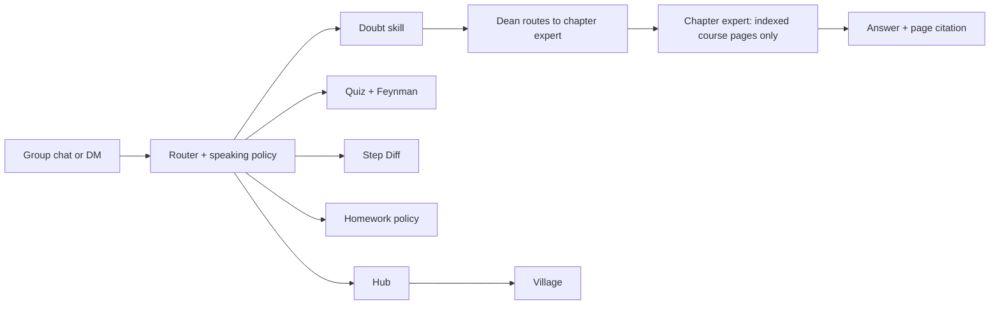

# Track 3: Cubbie Study Group, "Stats Midterm Grind"

`@cubbie` in your class group chat: answers doubts from your own course files with citations, quizzes the group, and finds your first wrong step.

Capture to add: `docs/demo/media/track3.gif` (20-second loop: chapter house doubt, expert call, quiz).

## The problem, in a student's words

"The group chat has the question and forty wrong answers. Nobody has the professor's slides open."

## Demo walkthrough (about 2 minutes, Replay `track3`, 114 s)

Course pack: OpenStax Introductory Statistics 2e excerpts (chapters 2, 3, 6, 12). Group: "Stats Midterm Grind" with Ana (presenter), Ben, Chris, Dev.

| # | Beat | What happens | Criterion |
| - | ---- | ------------ | --------- |
| 1 | Hook (`hook`) | The group is mid-panic: "is a z-score of 2 about 95%?" The dean wakes in the village at dusk | Use case |
| 2 | Chapter house doubt (`doubt`) | Ana walks to the Chapter 6 house and asks "why does the Empirical Rule say about 95% is within two standard deviations?"; the answer panel cites the page of our own file | Use case; accuracy |
| 3 | Expert call (`call`) | Ana joins the Chapter 12 expert; captions stream with citations to `ch12-linear-regression.pdf` | Use case; craft |
| 4 | Quiz (`quiz`) | Two students answer a Chapter 6 question; scores stay hidden by default; mastery changes privately | Group-chat manners |
| 5 | Step Diff (`step-diff`) | Two students DM photos of a least-squares problem; the group sees only where the work splits, no verdict | Use case |
| 6 | Personal goes private (`private`) | "how am I doing?" asks Ana by DM; nothing about her appears in the group | Group-chat manners; consent |
| 7 | Village is real (`council`) | The planner council debates a study plan (chill, grind, advisor with one dissent) while dusk falls | Craft; technical depth |
| 8 | Integrity close (`integrity`) | "help me with the HW3 graded question": a hint plus the syllabus policy, never the answer | Brand fit: integrity |

Honesty notes: the doubt answer panel and the Step Diff result are panels driven by hub endpoints and are not VillageEvents, so the Replay shows only the agent states around them; the presenter narrates the panel. The Replay shows call captions, quiz and mastery events, and the council events.

## How it works



Answers come only from the indexed course files, with a citation, otherwise "not in your materials".

## Speaking policy and integrity

- The bot stays silent until `@cubbie` is mentioned (or a skill scores 0.8 or more); anything personal moves to a DM.
- Squads under 3 hide counts and averages that could identify a person; quiz correctness is hidden by default.
- Homework help gives a hint and the syllabus policy line, never the answer to graded work.

## Run it

```sh
pnpm install && cp .env.example .env
pnpm demo:seed
pnpm demo:replay track3        # http://localhost:5180/squad/village?replay=track3
pnpm demo:preflight
```

Live needs `GEMINI_API_KEY`, `ELEVENLABS_API_KEY` for voices, and `imessage-kit` on a Mac (root README).

## Shared core, limits, next

- Same core as Track 2: [../track2/README.md](../track2/README.md). Track 1 (Exam Mode: Picture It and Recap Radio) is a separate submission.
- Seeded course pack, simulated students in the Replay; cost per question not yet measured.
- Next: podcast recap beat, Apple Messages for Business transport.
- Credits: see the root README (OpenStax CC BY 4.0 and all art packs).
