# The 13 rooms

Squad Village is a pixel campus. Each building is a **room**: a place where one kind of study help happens in the open, so your squad can see that it is happening without seeing your private answers. This page is the room reference. It is kept in step with `packages/village/src/scenes/roomInfo.ts` (the copy the app shows) and `docs/qa/ROOMS-AUDIT.md` (the engineering audit). Where code and audit disagree, the code on `origin/main` wins and this page says so.

For the step-by-step student view see [USER-GUIDE.md](USER-GUIDE.md).

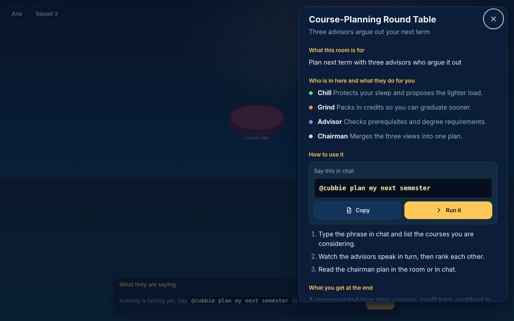

> **Status box (read this first).** Verified against `origin/main` at `39aa87e` (batch 1 landed).
>
> - On main today, a chat phrase starts a room for: **chapter houses 1 to 4** (`quiz`), **Round Table** (`plan my next semester`), **Feynman Porch** (`feynman`), **Panic Line booth** (`diff`). Council Hall runs only when a quiz key verifier is wired (it is not by default).
> - **On branch `rooms/a`, lands in batch 2:** Debate Stage (`debate <question>`) and Devil's TA (`devil's TA ch3 <topic>`).
> - **On branch `rooms/b`, lands in batch 2:** Exam Oracle (`exam oracle`, `what should I study next`), Rubric Courthouse (`rubric check`), Oral Exam Hut (`oral exam`).
> - **On branch `council/ask`, lands in batch 2:** Council Hall gets its own web panel and chat card, and a shared council service.
> - Until those land, the in-app info panel for those five rooms honestly says "nothing in chat starts this yet". This page lists the branch phrase separately so you can try it on the branch.
>
> Branch phrases come from reading the branch code (`git show origin/<branch>:<file>`), not from a merged build. Refresh this box when batch 2 lands.

## Table

| Room (slot) | What it is for | What to do (exact phrase) | What you get | Words and outcome shown? | Status on main | Branch / batch |
| --- | --- | --- | --- | --- | --- | --- |
| Chapter houses 1-4 (`chapter-1`..`chapter-4`) | Short chapter quiz from your own slides | `@cubbie quiz me on ch1` (also `chapter 3`, or just `quiz 3`) | Questions, whether you were right, which ideas to revisit and when. No grades. | Yes: question text, transcript strip, result mark | **Works** | none |
| Council Hall (`council-hall`) | Three blind solvers check a quiz answer key before you see it | Same as a quiz: `@cubbie quiz me on ch2`. It runs in the background when a question is made. | Three independent answers, the chair verdict (kept or dropped) | Yes: opinions and verdict | **Partial**: only runs if the quiz engine gets a verifier; `apps/bot/src/skills/index.ts` builds the engine without one by default (audit gap 2) | `council/ask`, batch 2 (web panel, hall, chat card) |
| Debate Stage (`debate-stage`) | Two sides argue a tricky question | none on main. On branch: `@cubbie debate should we ...?` | Both arguments and a closing summary | Scene supports it; no emitter on main | **Missing on main** | `rooms/a`, batch 2 |
| Course-Planning Round Table (`round-table`) | Three advisors argue out your next term | `@cubbie plan my next semester` (also `pick my classes`, `what classes should I take`, `register for next semester`) | A term plan: courses, credit total, workload in words, the one-line disagreement | Yes: advisors speak, rank, chairman plan card | **Works** (audit row updated by `ux/rooms`) | none |
| Feynman Porch (`feynman-porch`) | Explain an idea to a confused freshman | `@cubbie feynman ch3 gradient descent` | Up to two naive follow-up questions, then short written feedback | Chat yes; porch only partly (see note 1) | **Partial** | none |
| Panic Line booth (`panic-booth`) | Find the first step where two solutions split | In the group: `@cubbie diff` (add `private` to hide steps). Then two of you DM a photo of your work. | The step number where you split, not who is right | Chat yes; booth shows labels only (see note 2) | **Partial** | none |
| Exam Oracle (`exam-oracle`) | Suggest the chapter most worth studying next | none on main. On branch: `@cubbie exam oracle`, `what should I study next`, `predict my exam` | A chalk note such as "ch5 next?" | none on main | **Missing on main** | `rooms/b`, batch 2 |
| Oral Exam Hut (`oral-exam-hut`) | Practise answering an examiner out loud | none on main. On branch: `@cubbie oral exam`, `practice an oral` | Examiner questions as live captions | none on main | **Missing on main** | `rooms/b`, batch 2 |
| Rubric Courthouse (`rubric-courthouse`) | Check a written answer against Clarity, Accuracy, Gaps | none on main. On branch: `@cubbie rubric check`, or `check my answer against the rubric` | A tick or cross per criterion; feedback only, never a grade | none on main | **Missing on main** | `rooms/b`, batch 2 |
| Devil's TA (`devils-ta`) | Spot the deliberate mistake hidden in a worked solution | none on main. On branch: `@cubbie devil's TA ch3 gradient descent`, or `find the mistake` | A chalk tick if you caught it, a red underline if you missed it | none on main | **Missing on main** | `rooms/a`, batch 2 |

That is 13 slots: four chapter houses plus nine landmarks.

### Notes where code and audit differ

1. **Feynman Porch.** The audit says the engine animates the chapter house, not the porch, because it emits `expert:<chapter>` rather than `expert:feynman`. The app copy (`roomInfo.ts`) agrees and says "The porch itself does not light up yet." Treat the chat feature as working and the porch animation as unfinished.
2. **Panic Line booth.** Same pattern: the engine emits for `dean`, not `expert:stepdiff`, so the booth stays idle while the chat works.
3. **Round Table.** The audit's first table row still shows it as MISSING at audit time; its "Update (ux/rooms)" section and the code (`createCoursePlanSkill` is registered in `apps/bot/src/skills/index.ts`) show it works. This page follows the code.
4. **Phrase wording.** The study-plan skill (`study plan`, `plan the midterm`) is a different feature and does not use the Round Table. Course-planning phrases that mention study, exams, quiz or finals are deliberately left to the study plan skill.

## Room by room

### Chapter houses (4)

Practise one chapter with short questions built from your own course files. Answer with a letter or a few words. The house glows as the chapter sinks in. Your squad sees that you practised, not your answers.

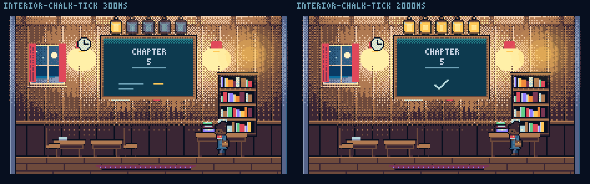

### Council Hall

Quiz answer keys are checked by three solvers who never see each other or the key. If anyone disagrees, the question is dropped. Only course questions are discussed here.

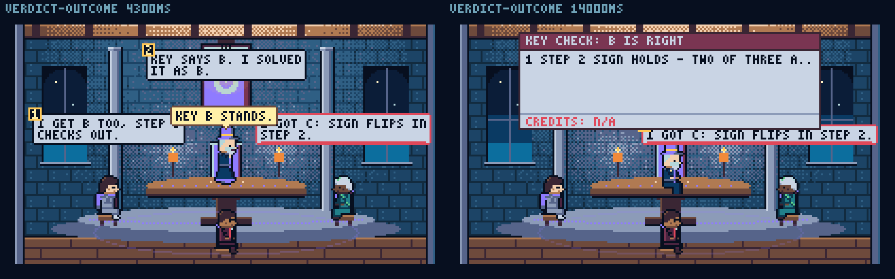

### Debate Stage

Meant for two sides of a debatable idea with a moderator summing up. Debates use course topics only.

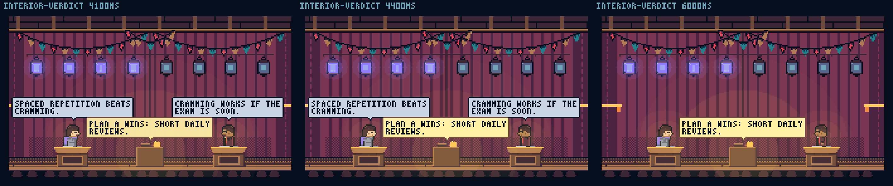

### Round Table

Chill protects your sleep, Grind packs credits, Advisor checks prerequisites, the Chairman merges them. It uses the sample catalogue and the courses you list, and nothing is shared with your squad unless you confirm.

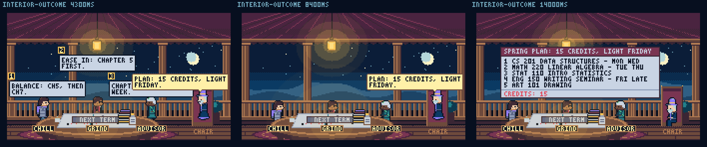

### Feynman Porch

You explain; a curious freshman asks why. Your explanation stays between you and Cubbie.

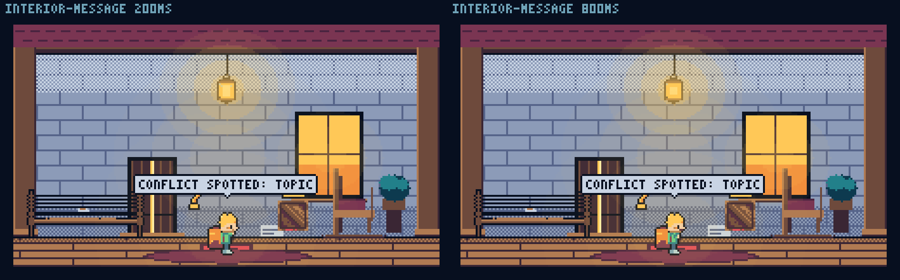

### Panic Line booth

Two photos of handwritten steps are lined up. Photos stay between you and Cubbie. The group sees only the step number.

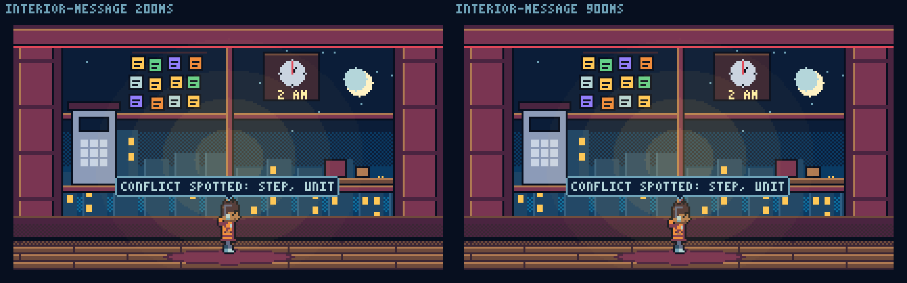

### Exam Oracle

Uses only your own study history to name the next chapter. Nothing is shared.

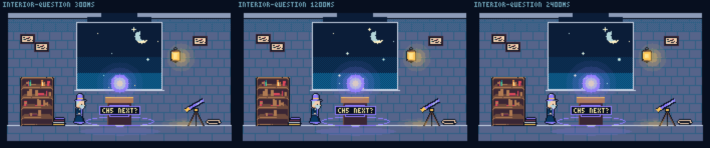

### Oral Exam Hut

Spoken practice with an examiner and live captions. It stays between you and the examiner.

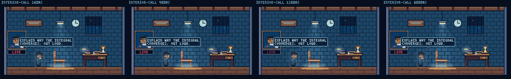

### Rubric Courthouse

Three criteria, ticks and crosses, never a number.

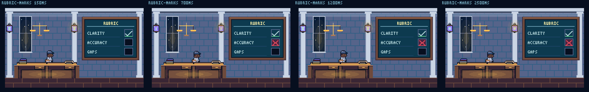

### Devil's TA

One hidden error. Only you see whether you caught it.

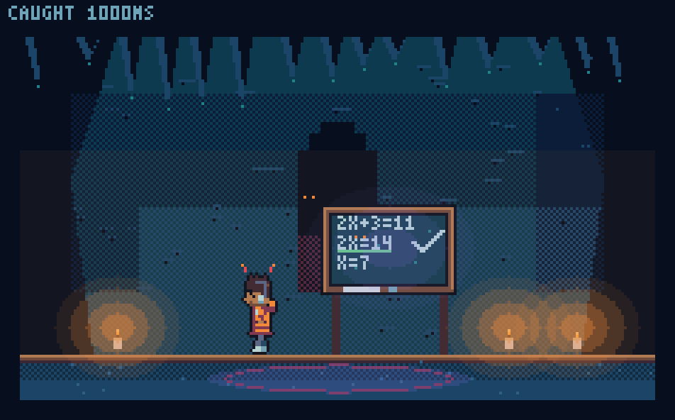

## Entering a room

Rooms need no phrase to visit. Walk your avatar to a door at `/squad/village`. Each room has an info strip and panel explaining who is inside, what to type, what you get and what is private. Scenes that have no live source yet are shown as an empty room, never a faked result. The Replay badge appears when the village plays a recorded run (`?replay=track2`).

## Keeping this page honest

Regenerate the table check by diffing against `packages/village/src/scenes/roomInfo.ts` (`how.phrase` per slot: chapters, council hall, round table, feynman, panic booth have phrases; the other five are `null`). When batch 2 lands, those five phrases move into `roomInfo.ts` and the status box above should be rewritten.
