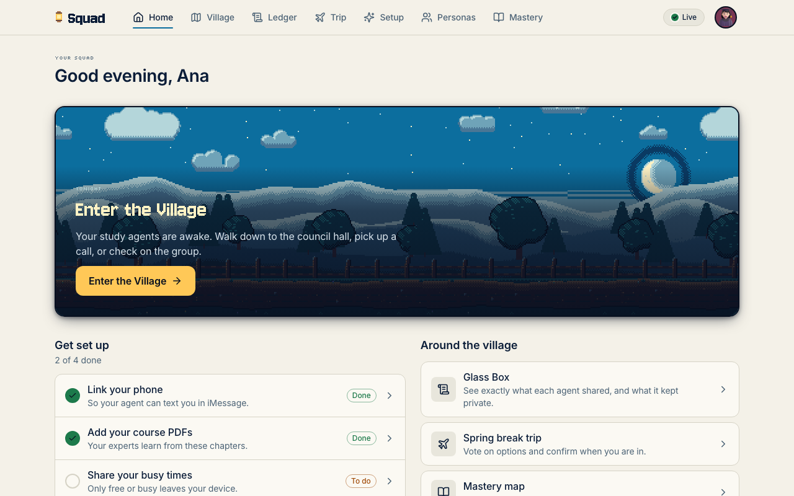
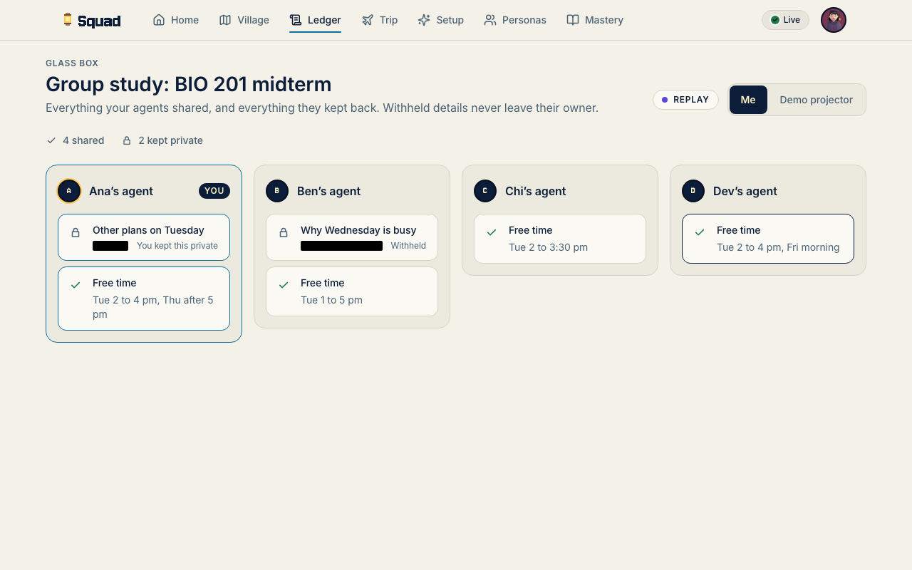

# Squad user guide (for students)

Squad gives your study group a bot, `@cubbie`, that lives in the group chat you already use, plus a private agent for each student and a pixel village that shows study help happening. This guide covers setting up, talking to Cubbie, every skill, every room, what is private, and what to do when something looks wrong.



> **Status box.** Written against `origin/main` at `39aa87e` (batch 1). Some skills are on unmerged branches and are marked "on branch X, lands in batch 2". Their phrases are read from branch code and are not yet in a merged build. See [ROOMS.md](ROOMS.md) for the room status table.

## 1. Set up

You (or a teammate running the demo) start Squad from a clone of the repo. Requirements: Node 20 or newer (`.nvmrc` pins 22) and pnpm 10.

```sh
corepack enable
pnpm install
cp .env.example .env
pnpm dev:all
```

`pnpm dev:all` starts the hub at <http://localhost:8788>, one agent per demo student on ports 4101 to 4104, and the web app at <http://localhost:5180> (it prints these). Open <http://localhost:5180/squad>. Add `--no-web` or `--no-agents` to skip parts.

Without any keys Squad runs in **demo mode**: answers come from a scripted stand-in model and the app says so (see section 7). To get real answers put `GEMINI_API_KEY` in `.env`; for spoken audio add `ELEVENLABS_API_KEY`. Never share these keys or commit `.env`.

The setup flow at `/squad/setup` has four steps:

1. **Phone**: link your mobile number with a 6-digit code.
2. **Courses**: drop your course PDFs. Cubbie reads them and answers from them with citations.
3. **Calendar**: upload an `.ics` file. Only free or busy blocks are kept; event titles never leave your device.
4. **Study buddy**: pick a persona for your private agent (`/squad/personas`).

## 2. Join a squad

Your squad is the group chat plus the people in it. Add Cubbie to the group chat (iMessage on a Mac signed into the bot Apple ID, Discord, or the command-line chat for testing: `pnpm bot:chat`). Everyone who set up Squad is a member. Squads of fewer than 3 people never get shared counts or totals (see section 5).

## 3. Talk to Cubbie

In a group, Cubbie speaks only when you **mention** it. These all count: `@cubbie ...` anywhere in the message, or a message that starts with `cubbie,` / `cubbie:` / `hey cubbie` (also `hi`, `hello`, `yo`, `ok`, `okay`). Words like "cubbies" or a plain mid-sentence "cubbie" do not. In a DM with Cubbie every message counts as addressed.

If you do not mention it, Cubbie stays quiet, with one narrow exception: if a skill is very confident (score of at least 0.8) it may chip in, at most once every 2 minutes. Most skills score 0 unless you mention Cubbie, so in practice a quiet group stays quiet.

Anything personal goes to a DM. Confirmations (nothing is booked or shared without a tap) arrive as a DM with options; reply with the number, the option text, or yes/no (also `yep`, `sure`, `ok`, `nope`, `cancel`).

## 4. Every skill and its exact phrases

Phrases are case-insensitive. Replace the examples with your own chapter or topic. Verified in the code listed on the right.

| Skill | Say this | What happens | Code |
| --- | --- | --- | --- |
| **Ask a doubt** (grounded answer) | `@cubbie why does the sample mean vary?` Any question: it needs a `?` or a word such as why, how, what, when, where, which, who, explain, define, `difference between`, `meaning of`, `tell me about`. | Answers from your course files with citations. | `packages/brain/src/skills/doubt/index.ts` |
| **Am I behind?** | `@cubbie am I behind`, `how am I doing`, `where do I stand`, `how far behind` | Reads your own mastery and tells you, privately. | `skills/behind/index.ts` |
| **Homework policy** | `@cubbie just do my homework`, `solve problem 3`, `give me the final answer`, `do hw 2` | Cubbie will not hand over graded answers. You get a hint and the course policy from your syllabus. | `skills/hwpolicy/index.ts` |
| **Quiz me** | `@cubbie quiz me on ch1` (also `chapter 3`, `quiz on 3`, `quiz 3`) | A short quiz on that chapter. Answer with a letter such as `B`, or a few words. | `skills/quiz/quizSkill.ts` |
| **Feynman** | `@cubbie feynman ch3 gradient descent` (chapter optional: `feynman gradient descent`) | You explain, a freshman asks up to two why questions, then written feedback. | `skills/feynman/feynmanSkill.ts` |
| **Step diff** | In the group: `@cubbie diff`. Add the word `private` to compare without showing steps. Then two people DM Cubbie a photo of their steps. | Cubbie finds the first step where you split, not who is right. | `skills/stepdiff/stepDiffSkill.ts` |
| **Study plan** | `@cubbie study plan`, `plan the midterm`, `plan the final`, `plan the exam` | A shared study plan built from each member's mastery and free time, by the agents, without exposing calendars. You confirm by DM. | `skills/studyplan/studyPlanSkill.ts` |
| **Course planning** (Round Table) | `@cubbie plan my next semester`, `pick my classes`, `what classes should I take`, `register for next semester`. Say a season, "light", "graduate early", "max 15 credits" or what you have finished to steer it. | Three advisors argue; the chairman gives one plan with credits and workload in words. Phrases with study, exam, quiz or final go to Study plan instead. | `skills/courseplan/skill.ts` |
| **Podcast** | `@cubbie podcast ch3`, `recap radio`. Add `my` or `for me` in a group for your personal cut (in a DM it is always personal). | A short audio recap of a chapter. Needs a voice key; otherwise you get "I couldn't make that just now". | `apps/bot/src/skills/media.ts` |
| **Explainer picture** | `@cubbie picture it ch3`, `explainer`, `diagram`, `infographic` | An image that explains the chapter idea. | `apps/bot/src/skills/media.ts` |
| **Plain chat** | Anything else, when you mention Cubbie | A short friendly reply. | `apps/bot/src/skills/chat.ts` |

If you ask for media on a chapter with no uploaded material, Cubbie says "I don't have course materials for that yet." Upload your PDFs in setup.

### On a branch, lands in batch 2

| Skill | Phrase | Branch |
| --- | --- | --- |
| Debate | `@cubbie debate should we ...?`, or `debate this` | `rooms/a` |
| Devil's TA | `@cubbie devil's TA ch3 gradient descent`, `find the mistake` | `rooms/a` |
| Exam Oracle | `@cubbie exam oracle`, `what should I study next`, `predict my exam` | `rooms/b` |
| Rubric check | `@cubbie rubric check`, `check my answer against the rubric` | `rooms/b` |
| Oral exam | `@cubbie oral exam`, `practice an oral` | `rooms/b` |
| Council on demand | council panel and chat card | `council/ask` |

## 5. The rooms

The village has 13 rooms. You can walk into any of them at <http://localhost:5180/squad/village>; each one has an info panel that says who is inside, what to type, what you get and what is private. The full table, with status and screenshots, is [ROOMS.md](ROOMS.md). In short:

| Room | For | Try |
| --- | --- | --- |
| Chapter houses 1 to 4 | Quiz one chapter | `@cubbie quiz me on ch1` |
| Council Hall | Blind check of quiz answer keys | runs behind quizzes (partial on main) |
| Debate Stage | Two sides of an argument | on branch `rooms/a` |
| Round Table | Plan your next term | `@cubbie plan my next semester` |
| Feynman Porch | Explain an idea simply | `@cubbie feynman ch3 gradient descent` |
| Panic Line booth | Find where two solutions split | `@cubbie diff` |
| Exam Oracle | What to study next | on branch `rooms/b` |
| Oral Exam Hut | Practise aloud | on branch `rooms/b` |
| Rubric Courthouse | Check against criteria | on branch `rooms/b` |
| Devil's TA | Find the planted mistake | on branch `rooms/a` |


Other pages: `/squad/ledger` (the disclosure ledger), `/squad/trips/:tripId` (the trip plan), `/squad/mastery` (your own progress), `/squad/personas` (your study buddy). The village shows a **Replay** badge when it plays a recorded run (`?replay=track2` or `?replay=track3`) rather than live events.



## 6. Privacy, in plain words

What is shared with your squad:

- That you practised a chapter or joined a plan, and public room words such as a council verdict.
- Group-level results that need several people: common free time, a budget everyone can afford, vote and topic totals. Only totals come out, never one person's input.
- Labels in the disclosure ledger such as "budget cap: hidden". The ledger records that something was withheld, never the value.

What is never shared:

- Your calendar events (titles, places, notes), your budget, your private answers, your DMs, and the photos you send for step diff.
- Another person's agent cannot ask your agent for your budget. It gets `query.denied`, and the attempt shows up on the notice board as a blocked row that names no value.
- Squads of fewer than 3 people get no counts or totals, because with 2 people a total reveals the other person's input.
- Nothing is booked or locked without your tap.

How it works, and its limits, stated honestly: common free slots use private set intersection (ECDH on ristretto255); budget, veto, ranked-vote and topic counts use additive secret sharing so only totals are revealed. This is **not zero-knowledge**. It assumes participants follow the protocol; an agent that lies about its own numbers is not caught. Things you trust our code for: the privacy gate that drops any message containing a private value, each agent computing its own bits honestly, the ledger, and your DMs. The full table is in [`packages/mesh/README.md`](../../packages/mesh/README.md).

Cubbie answers from your own course files and shows its citations. For graded homework it gives a hint and your syllabus policy, never the answer.

## 7. Troubleshooting

| Symptom | What it means and what to do |
| --- | --- |
| Banner says "Demo mode" | No `GEMINI_API_KEY` was found, so answers come from the scripted stand-in. Add the key to `.env` and restart `pnpm dev:all`. Check <http://localhost:8788/v1/status>. |
| `/v1/status` shows `"llm":"fake"` with a `reason` | `no_key` (no key), `forced_fake` (`FORCE_FAKE_LLM=1`), `credits_depleted` (Gemini billing out of credits; rechecked every minute), `invalid_key` (key rejected; rechecked every 10 minutes), `rate_limited` (Gemini is limiting you; recovers on its own). It switches back to the real model by itself once a probe succeeds; `nextProbeAt` shows when. |
| `"tts":"none"` | No `ELEVENLABS_API_KEY`; podcasts are unavailable. Text features still work. |
| Cubbie does not answer in the group | You did not mention it. Use `@cubbie ...` or start with `cubbie,`. |
| "I don't have course materials for that yet." | Upload your PDFs in `/squad/setup`, and name a chapter that exists. |
| Blank village | The village loads only on its own page. Hard reload `/squad/village`. For the offline demo use `/squad/village?replay=track2`. |
| Port already in use | `pnpm dev:all` honours `DEV_ALL_HUB_PORT` and `DEV_ALL_WEB_PORT`. Free 8788 and 5180, or set those. |
| Install or run errors | Use Node 20 or newer and pnpm 10 (`corepack enable`). Run `pnpm squad:doctor` to check your setup. |
| A room says nothing in chat starts it yet | That feature is on a branch that has not landed. See the status box in [ROOMS.md](ROOMS.md). |
| Step diff waits | Both people must DM Cubbie their photo (or a multi-line text of their steps). |

For the five-minute demo with no keys and no phones, use `pnpm demo:seed` then `pnpm demo:replay track2` (see the root README).
