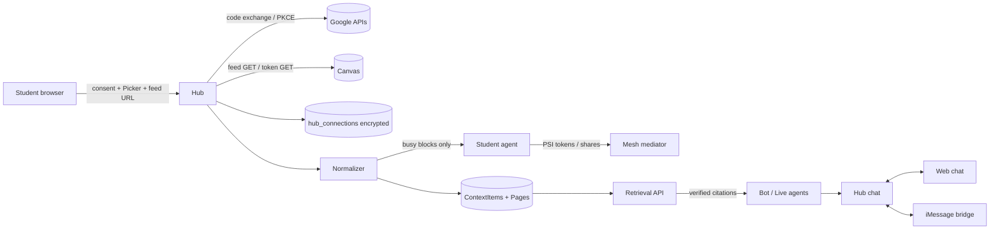

# Squad end-to-end product review and plan

Status: review at `origin/main` 449ae51 (2026-10-25). Docs only. Evidence is a mix of **[run]** (I drove it on a private stack, hub 8902 / web 5302 / agents 4601-4604, Gemini probing live) and **[code]** (read from source, not run). Screenshots are in `docs/design/shots/review/`. The companion gate spec is `docs/plans/RELEASE-GATE.md`.

Other agents are fixing loading, chat, raw-id and setup bugs; those are only recorded here (section 5), not planned.

## Top findings

1. **Canvas does not exist in code.** No API client, no feed fetch, no assignment or due-date model. Specs mark it "Later" (B12) and `docs/DECISIONS.md:4` says "No Canvas in the demo" [code].
2. **Google is a 32-line stub.** `apps/agent/src/google.ts` `fetchFreeBusy` has no callers, no OAuth, no storage; Docs/Drive/Gmail/Classroom are absent [code].
3. **The setup `.ics` upload never reaches the hub.** `packages/web/src/pages/setup/index.tsx` `onPick` parses locally and never calls `postCalendar`; the hub route also only accepts multipart while the web client sends `text/calendar` [code].
4. **Privacy copy overstates.** "It only sees free or busy, never what the event is" (setup, home) [run] is false for storage: `hub_busy_blocks` keeps title/start/end in plaintext (`apps/hub/src/store/schema.ts:19`).
5. **Only `@cubbie` / `@squad` are mentions.** The popup lists exactly those two [run]. `@tutor explain the normal distribution` was silently ignored: no reply, no error, no hint [run]. Personas `tutor, skeptic, planner, examiner, chair` exist in `packages/core/src/live.ts:217` but are not addressable in chat.
6. **iMessage is one-directional for humans.** Web humans never appear in the iMessage group (deliberate), no GUID<->hub id mapping, no backfill/reconnect, no persisted delivery state, no attachments; only proven against `FakeIMessageTransport` [code].
7. **No shared study plan object.** `@cubbie study plan` produced a private "Join the study plan?" DM and left the group with "Cubbie is thinking" [run]; the plan is not stored and has no page or edit/accept flow [code].
8. **Trip page lies when the trip is missing.** A new squad hits `GET /v1/trips/trip_cabo` -> 404 and the UI says "The hub did not answer" [run]. There is also no way to create a trip, only agent fixtures (`apps/agent/fixtures/trips.json`).
9. **Citations assume PDF pages.** Identity is `(file, page)` and `[file p.N]` markers; `resolveSource` rejects non-`material` files (`packages/brain/src/library/source.ts:36`). Canvas/Drive sources need a `kind`/`uri` generalisation [code].
10. **Agents have no retrieval tool.** The A2A surface (`apps/agent/src/server.ts`) only supports a fixed `QUERY_ABOUT` enum; `Brain.ask` is not reachable from an agent [code].

Recommended first three workstreams: **WS-A chat mentions + honest feedback**, **WS-B context store + citation generalisation (fake Canvas/Google fixtures first)**, **WS-C iMessage identity/sync layer**. See section 6.

---

## 1. Context ingestion audit

### 1.1 What exists

| Capability | Exists | Real/stub | Files | Gap |
|---|---|---|---|---|
| Course PDF/txt/md ingest | yes | real (unpdf, Gemini vision for sparse pages) | `packages/brain/src/ingest/*`, `apps/hub/src/routes/library.ts`, `routes/domain.ts` | PDF only; limits 25 MB/file, 400 pages/file, 40 files/course; no docx/pptx |
| Syllabus | partial | real, policy text only | `ingest/chapters.ts:110` `ingestSyllabus`, `PUT /v1/library/courses/:id/syllabus` | no exam/due-date parsing, no syllabus PDF route |
| `.ics` parse | yes | real, minimal | `packages/core/src/ics.ts`, `apps/agent/src/ics.ts`, `packages/web/src/pages/setup/ics.ts` | TZID ignored (treated UTC), no RRULE/EXDATE expansion; three copies |
| `.ics` upload -> hub | partial | hub real, web path broken | `routes/domain.ts:164` `POST /v1/squad/calendar`, `security/upload.ts` | see finding 3; route cap 5 MB vs guard 1 MB |
| Busy blocks -> agent -> mesh | yes | real if `AGENT_PEERS` set | `adapters/real.ts:323`, `agent/server.ts /internal/calendar`, `mesh/flows/hooks.ts` | push failure only logged; no per-squad consent/revoke |
| Google freeBusy | stub | HTTP code only | `apps/agent/src/google.ts` | needs OAuth, scopes, refresh |
| Canvas | none | n/a | specs only | everything |
| Docs/Drive/Gmail/Classroom | none | n/a | none | everything |
| Citations/source viewer | yes | real, PDF-page based | `packages/brain/src/citations/*`, `packages/web/src/components/source-viewer/*` | no kind/uri model |
| Retrieval | yes | BM25 chapter routing + whole-chapter expert context, max 4 claims, verbatim quote check | `brain/src/dean/bm25.ts`, `experts/*` | no embeddings (out of scope per spec 03), no agent-callable tool |

Env: only `GOOGLE_ACCESS_TOKEN` (commented, unused). Live vs mock honesty: setup labels "demo calendar" correctly, but there is no banner for hub-offline or mock mode on the calendar step or courses page.

### 1.2 Principles (from `docs/specs/04...`, `docs/security/THREAT-MODEL.md`, and Nook/Cubbie docs)

Squad is standalone now and mounts into Nook later (`docs/specs/00-OVERVIEW.md`, `DECISIONS.md`). The privacy stance to preserve: raw private fields never leave an agent, outbound text passes a strict gate, aggregates hidden below 3 members, per-viewer event filtering default-deny. Any integration must follow: **derive on the server, store the minimum, label every source, never ship tokens to the browser.**

### 1.3 Canvas architecture (ranked by feasibility)

| Option | What it gives | Effort | Risk | Verdict |
|---|---|---|---|---|
| A. Canvas **calendar feed URL** (`.ics`, per-user secret URL from Canvas Calendar > Calendar Feed) | assignment due dates, events, course codes in titles | S (2-3 d) | low: no OAuth, no institution approval; the URL is a bearer secret | **do first** |
| B. **Course-file export** (`.imscc` / exported zip, or student downloads files) uploaded to the existing ingest | lecture PDFs, syllabus | S-M | low | do second (zip unpack -> existing pipeline) |
| C. **Personal access token** (student-generated, optional) against Canvas REST `/api/v1/courses`, `/assignments`, `/files` | assignments + descriptions + files, grades excluded | M (4-5 d) | medium: many institutions disable student tokens; token is a long-lived secret | optional later, behind a flag |
| D. LTI 1.3 / OAuth2 developer key | proper scoped access | L | high: needs institution admin to register a developer key | not feasible for a hackathon; document only |

Design for A+B+C: a `CanvasSource` adapter produces normalised items:

```
ContextItem {
  id, squadId?, ownerId, kind: 'assignment'|'event'|'file'|'page',
  source: 'canvas'|'google-calendar'|'drive'|'classroom'|'upload',
  courseId?, title, dueAt?, startsAt?, endsAt?, text?   // text only for kinds that are readable by agents
  externalUrl, fetchedAt, visibility: 'private'|'squad', contentHash
}
```

Rules: feed URL is stored encrypted server-side (AES-GCM, key from env), never returned by any API after save (only `hint` = host + last 4 chars); poll with ETag every 6 h with a hard cap on items (500) and bytes (2 MB); grades/submissions/comments are out of scope and dropped at parse. Revocation: delete URL + derived items in one call; show "Canvas disconnected" with timestamp.

### 1.4 Google Workspace architecture (minimal scopes)

| Surface | Scope | Why this one | Notes |
|---|---|---|---|
| Calendar | `https://www.googleapis.com/auth/calendar.freebusy` (preferred) or `calendar.readonly` | freebusy returns busy intervals only, no titles; readonly needed only if due-date events must be read | start with freebusy; non-sensitive-ish and smallest |
| Drive | `drive.file` + Google **Picker** | app only sees files the user explicitly picks; no restricted-scope verification | preferred over `drive.readonly` (restricted, needs security assessment) |
| Docs content | covered by `drive.file` export of picked files (export as text/PDF through Drive API) | avoids `documents.readonly` | |
| Classroom | `classroom.courses.readonly`, `classroom.coursework.me.readonly` | assignments + due dates for the student only | sensitive scope; only if the school uses Classroom |
| Gmail | none | out of scope: too sensitive | explicit non-goal |

OAuth: Authorization Code + PKCE, server side. Hub owns the redirect (`/v1/connect/google/callback`), state bound to session, `access_type=offline`, `prompt=consent` only on first grant, `include_granted_scopes=false`. Tokens: refresh token encrypted at rest in a new `hub_connections` table (`userId, provider, scopes, enc_refresh, status, expiresAt, revokedAt, lastError`); access tokens kept in memory only (1 h). **No token is ever sent to the browser or the agent process**; agents receive derived items only. Expiry/revocation: on `invalid_grant` mark `status=needs_reauth`, stop sync, show "Google needs reconnecting" in setup and home, and surface in `/v1/status`; user-initiated revoke calls Google's revoke endpoint then deletes the row and derived items. Consent screen must be "Testing" mode with the user's own account for the hackathon (OAuth client registration is an external blocker, see RELEASE-GATE).

Stored vs derived:

| Data | Stored | Derived/exposed |
|---|---|---|
| Calendar | hashed-or-plain busy intervals only (no titles from Google; for `.ics` drop `SUMMARY` at parse) | PSI free-slot tokens to peers; squad sees counts only above 3 members |
| Canvas/Classroom assignments | title, course, dueAt, url | squad-visible only if user opts in per squad; due items power study plan/exam countdown |
| Drive/Canvas file text | extracted text pages for chosen files | cited excerpts only, via `resolveSource` with role checks |
| Tokens | encrypted refresh token / feed URL | never |

Per-squad opt-in: new `x.squad.settings`-style flag `contextSharing: { calendar, assignments, files }` per (user, squad); default off; revoke removes the user's items from squad retrieval within one request.

### 1.5 Data flow



### 1.6 Retrieval layer with verified citations

- New `Brain.retrieve(viewer, squadId, query)` over `ContextItem`s + existing `Page`s, scoped by `visibility` and per-squad opt-in. BM25 first (already present); no vectors needed.
- Synthetic page model: each assignment/event becomes one `Page` of a synthetic file (`kind: 'canvas-assignments'`), so `Dean`, experts and `verifyClaims` work unchanged (as spec 03 B12 intends).
- Citation generalisation: add `source: {kind, uri}` to `Claim`, `ChatCitation`, `SourceQuery`, `SourceExcerpt`; extend marker regex to `[canvas:assignment-3]` / `[drive:file p.2]` while keeping `[file p.N]`; verifier still demands a verbatim quote present in the stored text. `resolveSource` gains per-kind resolvers; `SourceExcerptView` renders `externalUrl` for non-PDF kinds.
- Agent tool: new internal route `POST /internal/retrieve` on agents (guarded by `X-Nook-Internal`) calling hub `retrieve`, returning only verified citations through the privacy gate; add a `context.query` message kind to the mesh protocol only if cross-agent retrieval is required (default: no, retrieval stays viewer-scoped on the hub).
- Personal sources (calendar) are never retrievable by squad answers; they only feed scheduling.

### 1.7 Ranked implementation plan

| # | Item | Effort | Risk |
|---|---|---|---|
| 1 | Fix web `.ics` upload (multipart), drop titles at parse, fix copy | S | low |
| 2 | `ContextItem` store + normalizer + synthetic pages + citation `source` generalisation (fake Canvas first) | M | medium (touches core types) |
| 3 | Canvas feed URL connector + due dates -> study plan/exam countdown | S-M | low |
| 4 | `hub_connections` + Google OAuth (freebusy) + connections UI + revoke | M | medium (external client registration) |
| 5 | Drive Picker + `drive.file` import | M | medium |
| 6 | Retrieval API + agent `/internal/retrieve` + chat use | M | medium |
| 7 | Classroom readonly | S | medium (school-dependent) |
| 8 | Canvas token / zip export | M | medium |

---

## 2. Squad and group chat flow

### 2.1 Journey as built

Signup (`/welcome` -> name -> phone/email -> 6-digit code; dev builds show the code on screen) -> choose create/join -> create squad -> invite link `localhost:5302/join/XXXX-XXXX` (7-day expiry, revoke, single-use option) -> setup checklist (phone, courses, calendar, buddy) -> chat. Hub: `apps/hub/src/routes/{auth,squads,invites}.ts`, web `packages/web/src/auth/*`, `pages/{welcome,squad-create,squad-join,squad-members}`. **[run]** new-user signup, squad creation and invite all worked; a new squad shows "Counts stay hidden until 3 people have joined" which is honest.

### 2.2 Tags today

`@cubbie` and `@squad` (alias) only. Detection `apps/bot/src/mention.ts` (also `hey cubbie,`); DMs always count. The web composer popup (`packages/web/src/pages/chat/model.ts:276-320`, `Composer.tsx`) lists `@cubbie` "Ask your study buddy" and `@squad` "Ask the squad helpers" [run]. Policy `apps/bot/src/policy.ts`: mentioned group -> run top skill; unmentioned -> speak only if score >= 0.8 and 120 s cooldown; DM -> always. Replies are always Cubbie-voiced. Skills (`apps/bot/src/skills/*`) cover chat/Q&A with citations, quiz, podcast, study plan, council, live.

### 2.3 Proposed typed mentions

Alias table (documented in `docs/chat-api.md` and shown in the popup):

| Alias | Persona/agent | Answers as | Backed by |
|---|---|---|---|
| `@cubbie`, `@squad` | Cubbie (router) | picks a skill | bot router |
| `@tutor` | tutor (`ta`) | explains with citations | chapter expert via `Brain.ask` |
| `@skeptic` | skeptic (`council-hard`) | challenges the claim, asks for evidence | council ask-prompt skeptic |
| `@planner` | planner (`mediator`) | study plan / trip proposals | study plan skill + mesh flows |
| `@examiner` | examiner | quizzes | quiz skill |
| `@council` | chair | all of the above, structured card | existing ask-council |

Rules: parse **all** `@alias` tokens (word-boundary, case-insensitive, strip punctuation); unknown `@xyz` produces a visible system hint "I don't know @xyz. Try @tutor, @skeptic, @planner" instead of silence (today: silence [run]); multiple tags answer in mention order, one reply per tag, serialised, capped at 3; a tagged persona always replies (counts as `mentioned`), untagged unprompted rule unchanged; a DM-only tag from a group is refused with "ask in your DM". Each reply is attributed to the persona (portrait + name), not "Cubbie". Hooks: `packages/core/src/chat.ts` (`CHAT_AGENT_MENTIONS`, `ChatMessage.addressed`), `apps/bot/src/mention.ts` (`parseMentions`), `policy.ts`, `skills/chat.ts` + `persona.ts`, `apps/hub/src/chat/{engine,hub-chat}.ts` (typing per persona), web `model.ts`/`Composer.tsx`/`Bubble.tsx`, tests `mention.test.ts`, `policy.test.ts`, `model.test.ts`.

**Tag -> A2A delegation.** A tagged skill that needs another student's agent (trip, study) calls the existing `apps/agent` `/internal/start/{trip,study}`; the agent exchanges A2A tasks (`POST /a2a`, states submitted/working/input-required/completed/failed/canceled) with peers through the mesh; only the aggregate result returns to chat. The chat message should carry a `taskId` so the card can show live task state (see 3.1).

### 2.4 DM boundaries

Access is default-deny (`apps/hub/src/chat/access.ts`): `group:<squadId>` visible to the squad, `dm:<studentId>` to its owner; group gets only "Sent you a DM." Group bot output passes a leak guard (`hub-chat.ts:332`). Confirm cards are DM-only. Gaps: leak guard is a sentinel + ledger list, not general; `@planner` must not echo private limits.

---

## 3. Collaborative trip planning and shared study plan

### 3.1 Trip

Built: PSI over days, secret-shared affordability, vetoes, Borda ranking, top 2, simulate, per-member confirm, `trip.confirmed` exactly once, shuttle cutscene (`packages/mesh/src/flows/trip.ts`, `PROTOCOL.md`, `apps/hub/src/routes/domain.ts` `/v1/trips/:id[/vote|/confirm]`, `packages/web/src/pages/trip/TripView.tsx`, `packages/village/src/cutscene/trip.ts`). Group size: min 3 for aggregates (`packages/core/src/group-size.ts`). **[run]** On the seeded Demo squad the trip page showed options, private limits ("up to $180", "Topic: therapy" visible only to self), "0 of 4 have voted" and per-member confirmation waits. Real vs scripted: mesh and hub are real; options are fixtures (`apps/agent/fixtures/trips.json`, fixed Dec window); confirm answers come from the scripted answerer by default.

Gaps: (1) no trip creation UI/route; (2) new squad page hard-requests `trip_cabo` and mislabels a 404 [run]; (3) offline agent state is a browser/hub banner only, not per member ("Ben's agent is offline, planning paused"); (4) no revote/deadline, no nudges ("3 of 4 voted"), confirm is all-or-nothing; (5) hub vote and mesh Borda look like two paths, unconfirmed they connect; (6) no concurrent-edit rule.

Proposed UX: `@planner plan a trip` in chat creates a **Trip object** (destination options, date window, budget band; creator can edit until "open voting"). Trip page shows per-member chips: `not voted / voted / confirmed / agent offline (since 14:02)`; top two candidates side-by-side with common dates and your share; limits never shown to others. Deadline default 24 h, DM nudge at T-4 h to non-voters; when all confirm, group chat card + cutscene deep link.

**Conflict rule (trip and study plan)**: optimistic concurrency. Every plan/trip has `rev`; edits send `baseRev`. Non-overlapping field edits merge automatically; same-field edits: last write loses with a 409, the loser sees "Dev changed this while you edited. Keep theirs / Replace with mine" and the change is logged in the chat thread. Votes are per-user rows so they never conflict (revote replaces your own row).

### 3.2 Shared study plan

Built: `packages/brain/src/studyplan/{assign,plan,scheduler}.ts` (snake-draft chapter assignment from private mastery, loads within 1; mesh slots; per-member DMs with a yes/no confirm), skill `@cubbie study plan`, mesh study flow with PSI hourly slots and `topicCoverage` (hidden below 3), nudges from the bot scheduler (9 pm due tomorrow, 6 pm review, exam T-7/T-3/T-1, quiet hours, daily caps, opt-in). **[run]** `@cubbie study plan` sent "Join the study plan? You own ch12. First slot 2026-10-26 19:00 UTC." to the DM only, group stayed on "Cubbie is thinking".

Gaps: no persisted plan, no `/v1/plans`, no web page; no edit/swap/accept; declines do not re-plan; per-member load shown as a chapter list only; exam countdown is per-student DM; nudges do not cover plan state; due dates come from nowhere until Canvas ingest exists; time shows UTC.

Proposed UX: `/squad/plan` page with one **Plan object** `{courseId, examAt, chapters[{id, ownerId, status}], slots[], rev, acceptances{}}`; countdown ribbon; chapter cards with owner chip and mastery word; "N of M accepted"; swap request that the other owner accepts; suggested slot in local time; decline triggers a re-plan proposal. Nudges: pending-accept DM at 24 h, T-minus reminders, "your slot starts in 1 h", weekly "your chapters" recap. Group chat gets one summary card linked to the page; privacy: no one's mastery numbers below 3 members.

---

## 4. Journey matrix

Legend: [run] verified by me, [code] read only, [e2e] covered by default harness (`e2e/`, ports hub 8851 / web 5251 / agents 4151-4154, `pnpm e2e`, `E2E_REUSE=1` with `stack-up.sh`; `LIVE=1` reuses the same specs against real models; `liveGuard` skips when LLM is down; no spec is LIVE-only).

| # | Journey | Steps | Expected | Status | Owner files | e2e |
|---|---|---|---|---|---|---|
| J1 | New user signup | /welcome name -> phone code -> choose | account + home | OK [run] | `packages/web/src/auth`, `hub/routes/auth.ts` | j01, j12 |
| J2 | Create squad + invite | /squad/new -> link | link w/ expiry | OK [run] | `routes/squads.ts`, `invites.ts` | j12 |
| J3 | Setup: courses | upload PDFs | chapters | OK [code,e2e] | `pages/setup`, `routes/domain.ts` | j01 |
| J4 | Setup: calendar `.ics` | upload | busy blocks reach hub+agent | **BROKEN web path** [code] | `pages/setup/index.tsx`, `api.ts`, `routes/domain.ts` | j01 only via API |
| J5 | Group chat Q&A with citation | `@cubbie what is a z-score?` | cited answer, chips | OK, ~15 s, [run] | `bot/skills/chat.ts`, `pages/chat` | j02 |
| J6 | Typed agent tag | `@tutor ...` | tutor answers | **Silent no-op** [run] | `bot/mention.ts` | none |
| J7 | Private DM | DM question | only owner sees | OK [code,e2e] | `chat/access.ts` | j03 |
| J8 | Quiz round | `@cubbie quiz me` | private feedback | OK [e2e] | `skills/quiz` | j04 |
| J9 | Ask council / live council | `@cubbie discuss:` | council card / live panel | OK scripted w/o credits [code] | `hub/live`, `web/live` | j05, live in unit tests |
| J10 | Trip planning | open trip, rank, confirm | confirmed once + cutscene | OK on seed [run]; new squad broken | `trip/TripView.tsx`, `mesh/flows/trip.ts` | j08-squad-flows, j10-trip |
| J11 | Shared study plan | `@cubbie study plan` | shared plan, accept/edit | DM only, no object [run] | `brain/studyplan`, none for web | j08-squad-flows (scheduling only) |
| J12 | Exam countdown / nudges | add exam, wait | nudges T-7/3/1 | per-student DM [code] | `bot/scheduler` | none |
| J13 | Canvas connect | paste feed URL | assignments, due dates | not built | new | none |
| J14 | Google connect | OAuth, freebusy, Picker | busy + files | not built | new | none |
| J15 | Grounded context retrieval w/ citations | ask about assignment | cited from Canvas/Drive | not built | new | none |
| J16 | iMessage group `@cubbie` | bind via `join <code>`, tag | reply into same group | fake only [code] | `hub/imessage/bridge.ts` | none (unit w/ fake) |
| J17 | Web <-> iMessage sync | message either side | mirrored, ordered, deduped | partial: bot->iMessage only [code] | `bridge.ts`, `chat/store.ts` | none |
| J18 | Degraded/offline | stop agent / 402 | honest labels | partial: `/v1/status`, banners | `routes/status`, `pages/status` | j13-resilience, j14 |
| J19 | Mobile | 390x844 | usable | OK [e2e] | web | j12-mobile |

Harness additions needed (names reserved for `e2e/specs/`): `j20-context-connect`, `j21-context-citations`, `j22-typed-mentions`, `j23-imessage-sync`, `j24-shared-plan`, `j25-trip-create-offline`, `j26-release-gate` (see RELEASE-GATE.md).

---

## 5. Defect and improvement backlog (from the private stack, new-user pass)

P0 = blocks the product story, P1 = visible quality/honesty, P2 = polish. Screenshot names are in `docs/design/shots/review/`.

| ID | Pri | Issue | Steps | File guess | Shot |
|---|---|---|---|---|---|
| D1 | P0 | `@tutor`/unknown `@x` silently ignored, no reply or hint | Ana in Demo squad chat, send `@tutor explain the normal distribution` | `apps/bot/src/mention.ts`, `hub-chat.ts` | 23, 24 |
| D2 | P0 | Study plan result goes to DM only; group stays on "Cubbie is thinking"; no plan page | `@cubbie study plan` | `brain/studyplan/plan.ts`, `skills/studyplan`, `hub-chat.ts` | 24 |
| D3 | P0 | Setup `.ics` upload never posted to hub | /squad/setup/calendar -> Upload | `pages/setup/index.tsx:508`, `api.ts:62`, `routes/domain.ts:164` | 26 |
| D4 | P1 | Trip page for a new squad requests hard-coded `trip_cabo` (404) and says "The hub did not answer" (dishonest: hub answered 404) | Rhea (new squad) -> Trip | `pages/trip/useTrip.ts`, `routes/domain.ts` | 14 |
| D5 | P1 | Privacy copy "only free or busy... never what the event is" vs hub stores titles | Home checklist, setup calendar | `pages/home`, `pages/setup/index.tsx:~530`, `store/schema.ts:19` | 09, 26 |
| D6 | P1 | Status page asks for an admin token; page requests `/v1/admin/status` (404 for new user, 403 for Ana) producing console errors; "LIVE" pill shown on an access wall | /squad/status | `pages/status`, `routes/status.ts` | 15, 27 |
| D7 | P1 | Anonymous load fires repeated `POST /v1/auth/refresh` -> 401 console errors (x6 on one page) | open /welcome | `packages/web/src/auth/AuthProvider.tsx` | 02 |
| D8 | P1 | Mastery for a brand-new squad shows raw course code "CSE310" (not a course the user has) while Courses shows the sample "Introductory Statistics" | /squad/mastery as Rhea | `pages/mastery`, `hub/seed` | 16, 13 |
| D9 | P1 | Village HUD shows 9 single-letter chips with "z" badges (C D R F P E O R D); unexplained, no labels or legend | /squad/village | `packages/village/src/hud` | 11 |
| D10 | P1 | Reply latency ~15 s with only "Cubbie is thinking"; no progress, no live/degraded hint in the bubble | any `@cubbie` question | `pages/chat/Thread.tsx`, `hub-chat.ts` | 22 |
| D11 | P1 | Citation shown 4 times as chips plus a duplicate pill "ch6.pdf p.2"; same page repeated per sentence | z-score answer | `pages/chat/Bubble.tsx`, `citations/render.ts` | 24 |
| D12 | P2 | Dev-only toolbar checkboxes (Agentation) present in DOM of every page in dev | any | `apps/web-host` dev only | 04 |
| D13 | P2 | Home shows "Share your busy times" To do but nothing links iMessage/Google/Canvas status; no "Connections" page | Home | `pages/home` | 09 |
| D14 | P2 | Status/Live pill says LIVE even though TTS is off ("Voice previews are off") with no top-level degraded indicator | Personas | `shell`, `/v1/status` consumer | 17 |
| D15 | P2 | Study plan slot rendered in UTC | study plan DM | `brain/studyplan/plan.ts` | 24 |

Not reproduced because other agents are on it: loading screens, chat input bugs, raw-id display, setup glitches.

---

## 6. Workstreams, file ownership, acceptance, rollout

Ownership is by directory so streams do not collide. "Contract" files (shared types) are touched only by their named owner, others consume.

| WS | Name | Owns (write) | Consumes | Acceptance tests |
|---|---|---|---|---|
| A | Typed mentions + honest feedback | `apps/bot/src/{mention,policy,persona}.ts`, `skills/chat.ts`, `pages/chat/{model,Composer,Bubble}.tsx`, `docs/chat-api.md` | core `chat.ts` (A owns the mention constants only) | unit `mention.test`, `policy.test`, `model.test`; e2e `j22`: `@tutor` replies as tutor w/ citation; `@xyz` shows hint; two tags -> two ordered replies; DM-from-group refusal |
| B | Context store + citation generalisation | `packages/core/src/context.ts` (new), `packages/brain/src/{context,citations,library/source.ts}`, `source-viewer/*`, hub `routes/context.ts` | fixtures | unit: verifier rejects a quote absent from a Canvas item; e2e `j21` with fake Canvas fixture: cited assignment answer, source viewer opens external link |
| C | iMessage identity + sync layer | `apps/hub/src/imessage/*`, `apps/hub/src/chat/store.ts` (external-id table only), `apps/bot/src/imessage/*` | chat API | unit: GUID<->msg id map, dedupe, replay after restart, out-of-order; e2e `j23` with FakeIMessageTransport |
| D | Canvas connector (feed URL, then zip) | `apps/hub/src/connectors/canvas/*`, `pages/setup` Canvas step, `pages/connections` (new) | B | fixture feed -> items; revoke deletes items; bad URL error copy |
| E | Google OAuth + Picker | `apps/hub/src/connectors/google/*`, `hub_connections` store, `apps/agent/src/google.ts` (retire) | B | fake Google server: consent, refresh, `invalid_grant` -> needs_reauth, revoke; BLOCKED harness for real client |
| F | Calendar ingestion fix | `pages/setup/{index,api}.tsx`, `routes/domain.ts` calendar branch, `core/src/ics.ts` (TZID/RRULE, no titles) | none | fix D3, D5; unit RRULE/TZID; e2e: uploaded `.ics` busy blocks reach agent |
| G | Shared plan + trip objects | `packages/core/src/plan.ts` (new), hub `routes/{plans,trips}.ts`, `store/{plans,trips}.ts`, `pages/plan` (new), `pages/trip` | B (due dates) | e2e `j24`,`j25`: create, accept, swap, concurrent edit 409 + resolve, offline member chip, nudges |
| H | Honest status | `pages/status`, `routes/status.ts`, `shell` pill, home Connections card | all connectors report state | D6, D14; per-integration state: `live / degraded(reason) / off / blocked` |
| I | Release gate harness | `e2e/specs/j26-*`, `e2e/lib/fakes/*`, `scripts/gate/*` | all | RELEASE-GATE.md |

**Rollout order** (each step shippable alone, behind flags `CONTEXT_CONNECTORS`, `TYPED_MENTIONS`, `IMESSAGE_SYNC`):

1. F (small, fixes live bug + privacy copy) and A in parallel.
2. B, then D (Canvas feed) and G in parallel.
3. C (iMessage layer) in parallel with D; H grows with each connector.
4. E (Google) once B is stable; real OAuth after client registration.
5. I wires the gate; run fixture version continuously, real-integration version manually.

Merge hygiene: contract files (`core/chat.ts`, `core/context.ts`, `core/plan.ts`) have one owner each; others open a contract PR first. No stream edits `apps/web-host` routing except H/G adding two routes (`/squad/plan`, `/squad/connections`) in one coordinated PR.

---

## 7. iMessage sync design (summary; full test plan in RELEASE-GATE.md)

Current (see audit): `apps/hub/src/imessage/bridge.ts` calls `chat.send(viewer, body, {via:'imessage'})`; GUID only in `imsg_seen` dedupe; hub id `m_<seq>`; `chat_bindings(chat_guid, squad_id)`; bot output mirrors to bound chats; humans on web are not mirrored; no backfill; raw handles in memory only.

Target:

- **Identity**: table `chat_msg_xref(hub_msg_id, transport, external_guid, chat_guid, direction, status, sent_at)` unique on `(transport, external_guid)`. Inbound: insert xref before `chat.send`; replay of same GUID is a no-op returning the existing hub id. Outbound: insert `pending` row, send, update to `sent|failed` with Apple GUID when the SDK returns it.
- **Ordering**: hub `seq` is canonical for web; iMessage `date` kept as `origin_ts`; thread shows `seq` order but displays origin time; backfill inserts at the tail with `origin_ts` labelled ("received late").
- **Delivery state**: persist `queued/sent/dry_run/failed(reason)` per mirrored message; web bubbles show a small state ("Sent to iMessage group" / "Not delivered: rate limited, retrying" / "iMessage not connected"); no optimistic "delivered" unless Apple confirms; `dry_run` and `disabled` are labelled as such, never success.
- **Web -> iMessage mirror rules**: mirrored = bot/persona replies and **cards rendered as text** (existing); human web messages are mirrored only when the author turned on "Also post to iMessage group" per message, sent from the user's own Mac account with a visible prefix `Rhea (via Squad): ...`, because impersonation is deliberately blocked today (`docs/imessage.md:27`); never mirror DMs to a group; never mirror private cards; leak guard applies.
- **Reconnect/backfill**: persist a `last_seen_rowid` per chat from `chat.db`; on start or watcher error, restart with exponential backoff and query `rowid > last_seen`; dedupe via xref.
- **Attachments**: inbound allowed kinds image/pdf <= 10 MB through the existing upload guard into the course/context pipeline, with the sender's explicit "add to course" reply; outbound remains title + web link until verified on real Apple.
- **Multi-thread routing**: `chat_guid -> squad_id` (many chats per squad, one squad per chat); a user in several squads is disambiguated by the chat binding, never by content; a 1:1 DM maps to `dm:<user>` and asks "Which squad?" when a request references squad data and the user has several.
- **Mention parsing**: one shared parser (`@cubbie`, `@squad`, `@tutor`, `@skeptic`, `@planner`, `@examiner`, `@council`, `hey cubbie,`) used by bridge, commands and web; iMessage has no mention entities, so text matching only; the alias list is documented in `docs/imessage.md` and echoed by Cubbie on `@cubbie help`.
- **Privacy**: group mirror obeys sentinels + ledger private values; no raw handles persisted; logs carry lengths only; allowlists `IMESSAGE_ALLOWED_CHATS/HANDLES` fail closed; kill switch `IMESSAGE_ENABLED=0`.

Unverified on real Apple: imessage-kit on macOS 27, `;+;` chat id shapes, group send by chat id, throttling, membership discovery. These stay labelled unverified and the gate reports them BLOCKED until the user's own allowlisted run passes.
