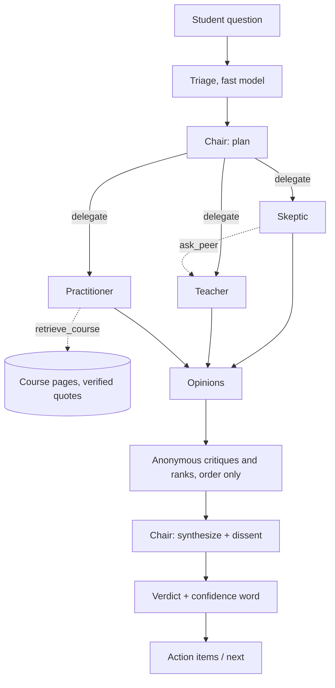
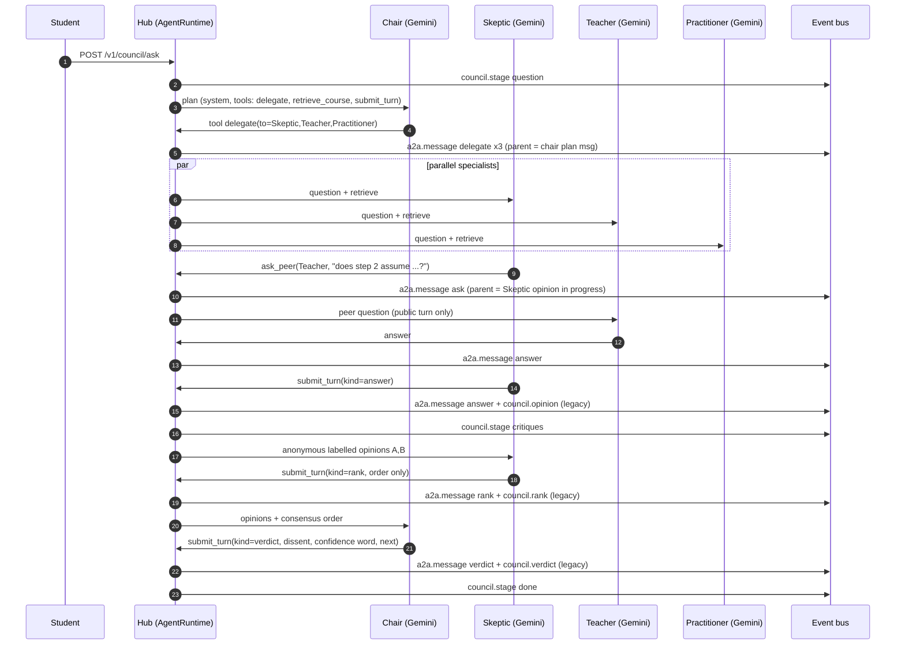
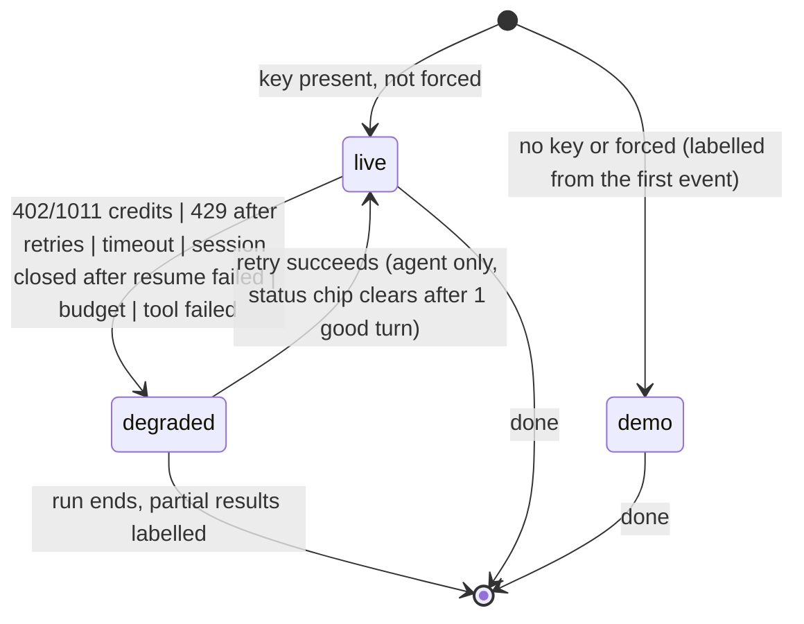

# Live Council: every council participant a real Gemini agent, visible hierarchy, honest status

Status: PLAN (docs only, nothing here is built). Written against `origin/main` at `449ae51` after reading the code named in section 0. Owner of the decisions in section 9 is the user.

Goal in one paragraph: every LLM council and every council participant runs as a distinct, real Gemini agent (own system instruction, own tools, own session). The student can see the hierarchy (chair at the top, delegations as branches), who talks to whom, the live agent-to-agent (A2A) messages, each agent's short public status and stance, and the chair's decision flow, without any raw chain of thought ever leaving the hub. Scripted text is never shown as if it were live: every agent and every council carries a `mode` badge (`live`, `degraded:<reason>`, `demo`) in events and in the UI.

Non-goals: gamification (no XP, streaks, boards, agent "scores"; confidence stays a word), exposing thinking tokens, a new transport for the village stream, changing quiz-key blindness.

---

## 0. What was read (so the claims below can be checked)

| Area | Files |
|---|---|
| Council engine | `packages/brain/src/councils/{council,ask-run,ask-prompts,ask-types,service,planner,quizkey,pure,demo}.ts` |
| Skills with councils | `packages/brain/src/skills/{debate/debate,courseplan/roundtable,oracle/skill,rubric/skill,devilta/skill,oral/examiner,council/index}.ts`, registered in `apps/bot/src/skills/index.ts` |
| Hub | `apps/hub/src/routes/council.ts`, `filter.ts`, `adapters/real.ts` (`councilDemo`), `chat/engine.ts` (`createResilientLlm`), `routes/admin.ts` (status), `live/*` (engine, gemini-client, fake-client, protocol, wire) |
| Core | `packages/core/src/{events,council,live,agent-id}.ts`, `llm/{types,gemini,fake,resilient,tools}.ts` |
| UI | `packages/web/src/council/*`, `packages/web/src/live/*`, `packages/village/src/inspector/*`, `packages/web/src/overlays/inspector/*`, `packages/village/src/scenes/{council-hall,landmarks/round-table,roomSeats}*` |
| Docs | `docs/council-api.md`, `docs/live-discussion.md`, `docs/inspector.md`, `docs/specs/08-village-motion.md`, `docs/cast-art.md` |
| Fixtures | `apps/hub/sim/replays/track{2,3}.json`, `packages/core/fixtures/sample-replay.json`, `FakeLlm` (`core/llm/fake.ts`), `FakeLive` (`hub/live/fake-client.ts`), `e2e/specs/j05-ask-council`, `j16-inspector`, `j17-room-inspector`; e2e forces `FORCE_FAKE_LLM=1` unless `LIVE=1` (`e2e/lib/stack.ts`) |

---

## 1. Honest inventory today

Legend. **G-std** = a Gemini standard `generateContent` call through `GeminiLlm` (`json()` with `responseJsonSchema`, or `complete()`); default tier models `fast=gemini-3.5-flash-lite`, `main=chair=gemini-3.8-flash`. **G-live** = a Gemini Live WebSocket session (`ai.live.connect`, default `gemini-3.8-live`). **Code** = deterministic TypeScript, no model. **Script** = canned text.

### 1.1 Councils and participants

| Council (agent id) | Participant | Real model path today | Scripted / fake path | Where scripted text can look live |
|---|---|---|---|---|
| Ask council (`council:ask`, `brain/councils/ask-run.ts`) | Triage (cheap gate) | G-std `fast`, `json` | none; failure fails open | none |
| | Skeptic, Teacher, Practitioner | G-std `main`, `json`, T=0.4, one call each, parallel, no tools, no memory | `createDemoCouncilLlm()` (deterministic) when `councilDemo()` is true | see 1.2 items A, B, C |
| | Peer ranking (each member) | G-std `main`, `json`, T=0, anonymous labels | demo model | same |
| | Chair | G-std `chair`, `json`, T=0 | demo model; on a chair failure the run keeps going with "top-ranked answer" text and a note | item D |
| | Grounding | `brain.ask` (LLM-assisted retrieval) plus code quote verification (`verifyClaims`) | `general` grounding says so plainly | none (honest) |
| Quiz-key (`council:quizkey`, `councils/quizkey.ts`) | solver-a/b/c | G-std `main`, blind, T=0 | FakeLlm in tests and demo; **verifier is omitted entirely with FakeLlm** (`real.ts` comment) so demo questions are unverified | none shown to students |
| | Chair | **Code** (`decide`), plus G-std `chair` JSON only for free-text equivalence | n/a | it is not an LLM agent; it must be labelled so, not dressed as one |
| Planner council (`council:planner`, `councils/planner.ts`: Chill, Grind, Advisor, chair) | all four | G-std through generic `createCouncilRun` | FakeLlm | **not wired in production** (only `realkey.script.ts`, record scripts); the shipped planner is the Round Table below |
| Round Table / course plan (`skills/courseplan/roundtable.ts`) | Chill, Grind, Advisor, Chairman | G-std via `createCouncilRun` wrapped by `guarded` llm | on any model error `usedFallback=true` and **persona `stock` text** is used, then code repairs the plan | item E |
| Debate Stage (`skills/debate/debate.ts`) | Pro, Con, Chair, judge/voters | G-std (`fast` for positions, `main` for debaters, `chair`, votes via `Promise.all`) | `stock(side, position)` text, "template text (demo mode)" note only inside `outcome.notes` | item E |
| Exam Oracle (`skills/oracle`) | Oracle | Ranking is **Code** (`rankChapters`); G-std `fast` only writes one question and a "why" | `defaultWhy` text | emitted as `council.opinion` from member `oracle` with no label |
| Rubric Courthouse (`skills/rubric`) | Rubric judge | G-std `main` (feedback; vision for attachments) | `rubricUnavailableReply` ("demo mode" in chat text) | chat text labelled; the `council.*` events are not |
| Devil's TA (`skills/devilta`) | Devil | G-std `main` plan, `fast` feedback | `pickDemo` canned mistake plan, `demo` stored on the session | the `quiz.question` event carries the canned text with no demo flag (chat text is labelled) |
| Oral Exam (`skills/oral/examiner.ts`) | Examiner | G-std `fast` (questions, follow-ups, judging) | `fallbackQuestion` from chapter titles, comment says "any LLM error ... deterministic fallback" | **no label at all** |
| Live Discussion (`hub/live/*`) | Chair, Tutor, Skeptic, Planner, Examiner | **G-live**, one `GeminiLive` session per persona, text relay between agents, audio plus `outputAudioTranscription` | `FakeLive` when no key, `FORCE_FAKE_LIVE=1`, or the first turn fails with credits/auth/rate/unavailable; run `snapshot.demo` + `note`; mid-run failure ends the run honestly (`finalize('error')`) | `discussion.turn` events carry **no per-turn `demo`**; only `started`/`ended` do |
| Live takeaways | Takeaway builder | G-std (`createLlmTakeaways`) | `heuristicBuilder` when demo | none (labelled with the run) |

Reality check on "live": **today only the Live Discussion uses Gemini Live.** Every other council participant is a one-shot G-std JSON call with no tools, no memory between phases (the rank call re-sends the opinions) and no session. None of them is "delegating" or "talking to" another agent; the code orchestrates three phases and the village animates them.

### 1.2 Where a fallback can silently show scripted text as live (findings)

A. **Per-call demo switching with a per-run flag.** `councilLlmFor(real, isDemo)` re-evaluates `isDemo()` on every call, and the hub's `councilDemo()` reads `runtime.llm().llm`, which flips to `fake` the moment the shared `ResilientLlm` sees a 402/429/401. `CouncilResult.demo` is fixed once, at `emptyResult(...)` time. So a run that starts real and loses credits half way can mix real opinions with demo ranks/verdict while `demo:false` (and no event says otherwise).

B. **Two different fakes behind one badge.** Below `councilLlmFor` the `o.llm` the council wraps is the hub's `ResilientLlm`, whose `fake` is the generic chat demo model (`createDemoLlm`), which the code itself notes "cannot produce council JSON". The result depends on which layer answered (member dropped, chair "did not respond", or a council-demo answer), none of it reflected in a per-agent mode.

C. **`work.demo` and `thought` exist in the schema (`events.ts` `WorkSchema`, `ThoughtSchema`) but no brain emitter sets them** (grep shows `work:` only in `hub/filter.ts`). The inspector therefore cannot show "Demo" on a council event even where it wants to.

D. **Chair failure** produces a verdict made from the top-ranked member's text with a note ("The chair did not respond..."), emitted as an ordinary `council.verdict`. The note is in `notes`, not in the event.

E. **Stock text in skill councils** (Round Table, Debate): the fallback is stated inside `outcome.notes` (a footnote), but the `council.opinion` events that animate the room and fill the inspector carry the stock text unlabelled.

F. **Oral exam and Oracle** fall back with no label at all.

G. **Live Discussion** labels runs, not turns (`discussion.turn` has no `demo`), and a viewer who joins a stream mid-run sees turns without the banner unless they also load the snapshot.

H. **E2E is almost entirely demo.** `e2e/lib/stack.ts` sets `FORCE_FAKE_LLM=1` unless `LIVE=1`, so passing e2e proves the UI, not the live path. That is fine for CI, but nothing asserts the Demo label is visible on every council surface.

Principle derived: **there is exactly one place that decides "real or scripted", it decides per agent per call, it tags the result, and the tag travels to the screen.** Section 5.

---

## 2. Target architecture

### 2.1 Vocabulary

* **Agent**: a named participant with a role, a system instruction, a tool set, a model/transport, a parent in the hierarchy, and a `mode`. Agent ids reuse `AgentIdSchema` (`council:<council>-<role>`, e.g. `council:ask-chair`, `council:ask-skeptic`; the existing `council:ask` stays as the room/council-level agent so village code keeps working).
* **Council run**: one `cn_...` id (existing). It is the A2A `correlationId`.
* **Live** means: a real Gemini model is generating this agent's turns now. Transport is a separate axis (section 2.4): `live-audio` (Gemini Live, voice), `live-text` (Gemini Live with TEXT output if a non-native-audio live model supports it; to be probed), `stream-text` (standard `generateContentStream` with function calling). All three are real; none is scripted. `demo` is the only scripted mode and is always labelled.

### 2.2 Roster

| Council | Hierarchy (top to bottom) | Notes |
|---|---|---|
| Ask | **Chair** -> Skeptic, Teacher, Practitioner (specialists). Specialists may `ask_peer` once. Chair `delegate`s sub-questions and `synthesize`s. | Anonymous ranking stays (order only), produced by each specialist as a `rank` message. |
| Round Table / planner | **Chairman** -> Chill, Grind, Advisor. Advisor may be asked by Chill/Grind to check a deadline. | Plan validity stays **code** (`rules.ts`); repairs are posted as `status` messages from a `code:validator` pseudo-agent labelled "checked in code". |
| Debate Stage | **Chair/Judge** -> Pro, Con. Pro and Con `ask` each other (rebuttal) through the chair. | Voters become a `vote` message per voter agent (cheap `fast` text). |
| Quiz-key | flat: solver-a, solver-b, solver-c (no peer contact, no key, blind); verifier is **code** | The hierarchy view shows "Verifier (code)" so no one thinks a model checked the key. Free-text equivalence stays one cheap G-std call from the verifier, labelled as such. |
| Exam Oracle | **Oracle** (G-std writes question/why) with `code:ranker` | Same labelling rule. |
| Rubric Courthouse | **Judge** (+ optional `Reader` agent for attachments) | |
| Devil's TA | **Devil** (plants mistake), **Grader** (code + `fast` feedback) | |
| Oral Exam | **Examiner** (single agent, voice-capable via Live) | Examiner is the natural first voice agent. |
| Live Discussion | Chair -> Tutor, Skeptic, Planner, Examiner (existing five) | Already G-live; migrate its events onto the envelope. |

### 2.3 Agent definition and tools

```ts
// packages/brain/src/agents/types.ts (sketch)
interface AgentSpec {
  id: AgentId;                     // council:ask-skeptic
  role: 'chair' | 'specialist' | 'solver' | 'examiner' | 'judge' | 'debater';
  parent?: AgentId;                // hierarchy edge for the org chart
  displayName: string;             // "Skeptic" (cast art key: chill|grind|advisor|chair)
  stance: string;                  // one public line, already used on cards
  system: string;                  // own system instruction + [prompt <version>]
  tools: ToolName[];
  tier: 'fast' | 'main' | 'chair';
  voice?: string;                  // Gemini prebuilt voice for live-audio (existing LIVE_PERSONAS.voice)
  limits: { maxTurns: number; maxOutputTokens: number; maxToolRounds: number };
}
```

Tools (all executed by the hub-side `AgentRuntime`, never by the model; each result is data):

| Tool | Who | Behaviour and privacy |
|---|---|---|
| `retrieve_course({query})` | all specialists, chair | Wraps `brain.ask` + `verifyClaims`; returns only pages whose quote verified; returns `{file,page,quote}`. Course text is **data**, wrapped and labelled as untrusted (prompt-injection guard). A specialist's `citations` in its turn are re-verified in code before they reach an envelope (existing behaviour, kept). |
| `calendar_summary({range})`, `mastery_summary()` | Planner/Round Table agents only | Viewer's **own** data only, through the existing mesh `Gate` (`packages/mesh/src/gate`, `answerQuery`) for anything shared; squad-visible runs get aggregates ("about 9 free hours Thu to Sun"), never event titles, amounts or the sentinels (`$180`, `therapy`). A denied query is a visible `ask` message to `tool:calendar` with `status:'failed'` and summary "denied by privacy gate", never silently empty. |
| `delegate({to, question, why})` | chair only | Runtime validates `to` is a child in the roster, depth <= 2, fan-out <= 3, no cycles (visited set). Creates a `delegate` envelope (parent = the chair's current message), runs the specialist, returns its **public turn** (summary, answer, citations) as the tool result. |
| `ask_peer({to, question})` | specialists | Same validator; at most one per specialist per run; peer sees only the question and the public turn of the asker, never the asker's system prompt. Creates an `ask`/`answer` pair. |
| `submit_turn({...PublicTurn})` | every agent, terminal | The **only** way an agent produces visible output. See 4. This is the structured-output channel on Live transports (Live native audio has no JSON schema mode) and is also used on `stream-text` so one contract covers all transports. |

Orchestration is code, not model free-for-all: the runtime owns the loop (`stage` state machine, section 6.4), enforces caps, and the chair's job is judgement (what to delegate, how to synthesize), not scheduling.

### 2.4 Transports, session lifecycle, budget

| Transport | What | When | Cost shape |
|---|---|---|---|
| `stream-text` (default) | `generateContentStream` + function calling on `gemini-3.8-flash` (tier models stay configurable) | Every council by default. Specialists run in parallel; token deltas become `status: working` previews only if they pass the public-turn parser (section 4). | per token; measure, then record in this doc (the repo does not hold a verified text price for 3.8-flash; do not guess) |
| `live-text` (probe first) | Gemini Live session with `responseModalities:['TEXT']` | Only if a Live model that is not native-audio-only accepts TEXT out. `docs/live-discussion.md` records that `gemini-3.8-live` is AUDIO-only, so this is **an open probe, not a promise**. If it passes it gives per-agent persistent sessions without audio cost. | per token |
| `live-audio` | Gemini Live native audio, `outputAudioTranscription`, one session per agent, one floor holder (the existing Live Discussion design) | User presses "Hear the council" | **measured**: audio out $0.018/min, audio in $0.005/min, text in $0.75/M tokens, text out $4.50/M (`docs/live-discussion.md`); measured about $0.02 per 60 s of discussion |

Cost per council with voice (estimate from the measured figure, to be replaced by a measured run): Ask council spoken length about 3 specialist answers x 15 s + 3 critiques x 8 s + chair delegation 10 s + verdict 25 s = about 105 s of audio out = **about $0.03**, plus relayed text input (about 8 turns x 1.5k tokens = 12k tokens = about $0.01). Round Table (4 agents, 2 rounds) is of the same order. So **about $0.04 per voiced council, about 5 to 15 per cent of which is text**. A text-only council costs tokens only. Quiz-key never uses audio (3 solves per generated question; always `stream-text`, `fast`/`main`). Voice has to be opt-in, capped, and off in Calm mode by default.

Why not Live for everything by default: native-audio Live is audio-only (so JSON/structured output must ride on a tool call), is billed per audio second even when captions-only, generates at roughly real time (10 to 14 s per turn measured, so 8 sequential turns is 80 to 110 s, over today's 90 s run cap), and has connection limits. Text transports let specialists run in parallel in about 10 to 25 s total. The runtime is transport-pluggable, so "all Live" is a config flip if the user wants it (decision 1 in section 9).

Session lifecycle (for `live-*`):
* Lazy open: a specialist's session opens when first delegated to, closes at `council.ended` (or 20 s after its last turn).
* Limits from `docs/live-discussion.md`: ~10 min connection, 15 min audio-only without compression, `GoAway{timeLeft}` first, resumption handles valid 2 h, `contextWindowCompression` lifts the cap. Today `gemini-client.ts` requests `sessionResumption: {}` and ignores `goAway`. Plan: store the latest resumption handle, on `GoAway` reconnect with it once; on failure mark `degraded:session_closed` (section 5). Councils run <= 4 min so this is rare; it matters for follow-up chat with a council.
* Concurrency caps (env, safe defaults): `COUNCIL_MAX_SESSIONS_HUB=12`, `COUNCIL_MAX_SESSIONS_RUN=6`, existing 1 active run per asker and 12/hour (voice runs: 4/hour), parallel specialist fan-out <= 3.
* Budget guard: `COUNCIL_MAX_USD_RUN` (default 0.10 voice, 0.03 text), token caps per agent, `maxToolRounds`, hard stop timer. The guard counts audio seconds and tokens from usage metadata; on breach the run ends `status:'done'` with `degraded:budget` on unfinished agents and a plain note, never a hang.
* Timeouts become mode-dependent: `stream-text` run 90 s (today), `live-audio` 240 s (today's `LIVE_MAX_SECONDS`).
* The key stays server-side (existing decision: hub proxies; no ephemeral tokens).

### 2.5 Hierarchy and decision flow (the chair delegates, specialists consult, chair synthesizes with recorded dissent)





Dissent is a first-class object: the chair's verdict turn must name `dissenter` and `why`; the runtime cross-checks it against the specialists' committed `answer` fields in code (as `pickDissenter`/`decide()` do today) and refuses a verdict that contradicts a specialist's answer without a dissent record. The verdict envelope lists `dissentRefs: [messageId]` pointing at the dissenter's `answer` message, so the UI can link verdict to the dissent card. Confidence stays a word, capped in code by evidence (existing logic in `ask-run.ts decide()` is kept as the safety cap).

---

## 3. A2A message protocol over the existing bus

### 3.1 Envelope (zod, `packages/core/src/a2a.ts`, browser-safe, exported from `packages/core/src/index.ts`)

```ts
export const A2aMessageIdSchema = z.string().regex(/^am_[a-z0-9]{12}$/);
export const A2aKindSchema = z.enum([
  'delegate', 'ask', 'answer', 'critique', 'rank', 'vote', 'verdict', 'status',
]);
export const A2aStageSchema = z.enum([
  'question', 'delegation', 'opinions', 'critiques', 'dissent', 'verdict', 'actions', 'done',
]);
export const A2aStatusSchema = z.enum([
  'queued', 'working', 'done', 'failed', 'skipped', 'partial',
]);
export const AgentModeSchema = z.union([
  z.literal('live'),
  z.string().regex(/^degraded:[a-z_]{3,32}$/),   // degraded:credits_depleted | rate_limited | timeout | session_closed | budget | tool_failed | chair_unavailable
  z.string().regex(/^demo(:[a-z_]{3,32})?$/),    // demo | demo:no_key | demo:forced
]);
export const A2aRedactionSchema = z.enum(['public', 'asker_only']);
// 'hub_internal' exists as a TypeScript type only: those envelopes are never serialised onto the bus.

export const A2aMessageSchema = z.strictObject({
  id: A2aMessageIdSchema,
  correlationId: CouncilRunIdSchema,          // cn_... (or ld_... for live discussion; union)
  seq: z.number().int().nonnegative(),         // monotonic per run, replay ordering + gap detection
  from: AgentIdSchema,                         // council:ask-chair
  to: z.union([AgentIdSchema, z.literal('room'), z.string().regex(/^tool:[a-z_]{2,24}$/)]),
  kind: A2aKindSchema,
  parentMessageId: A2aMessageIdSchema.optional(), // delegation tree edge
  stage: A2aStageSchema,
  summary: z.string().max(280).optional(),     // PUBLIC summary (see 4); absent after redaction
  stance: z.string().max(80).optional(),       // "leaning B, unsure about step 3"
  answer: z.string().max(240).optional(),      // committed short answer (opinions/verdict)
  order: z.array(z.string().max(40)).max(6).optional(), // rank: names only, best first
  confidence: CouncilConfidenceSchema.optional(),        // verdict only, a word
  dissentRefs: z.array(A2aMessageIdSchema).max(4).optional(),
  citations: z.array(CouncilCitationSchema).max(4).optional(), // verified in code
  status: A2aStatusSchema,
  mode: AgentModeSchema,                       // of the agent that produced it
  source: z.enum(['model', 'code', 'script']), // script only with mode demo or degraded
  partial: z.boolean().optional(),             // interrupted/cut-off text
  redaction: A2aRedactionSchema,
  ts: z.number(),
});
```

Strict (unknown keys rejected, like every other event). There is deliberately no field that could carry thinking text (`thought`, `reasoning`, `raw`, `signature` are banned by a schema test, section 4.4).

### 3.2 Mapping onto the existing VillageEvent kinds (additive only)

| Need | Mechanism | Back-compat |
|---|---|---|
| Typed A2A message | **one new kind** `a2a.message` in `VillageEventSchema` (`{ t:'a2a.message', msg: A2aMessage, ...Extras }`) | New discriminated-union member; old clients must ship the schema first (rollout step 1) |
| Stage progress | **one new kind** `council.stage` (`{ t, councilId, correlationId, stage, mode }`) | same |
| Opinion / rank / verdict | keep `council.opinion/rank/verdict` exactly as today (same fields, same hub filter), add optional `a2aId` pointing at the envelope | purely optional keys |
| Per-agent mode on every event | add optional `mode: AgentModeSchema` to `Extras` (applies to all kinds); populate the dormant `work.demo` from it so today's inspector "Demo" line starts working | optional |
| Mesh trade (`agent.message`) | unchanged (blinded values, mediator); mesh may later also emit `a2a.message` kind `ask/answer` for the trip planner | unchanged |
| Live Discussion | `discussion.turn` gains optional `a2aId`, `mode`; engine also emits `a2a.message` (`ask` when a persona hands over by name, `answer` for the turn); `discussion.*` stays | optional |
| Inspector | `registerExchangeMapper('a2a.', mapper)` (the extension point `conversation.ts` already offers) | no change to the switch |

Legacy events keep the current village animation and the iMessage/web chat card working untouched; the new kind is what the board and arrows read.

Event examples (JSON on the stream):

```json
{ "t": "council.stage", "councilId": "council:ask", "correlationId": "cn_k3j9x0a1b2c3", "stage": "delegation", "mode": "live" }
```
```json
{ "t": "a2a.message", "msg": {
  "id": "am_a1b2c3d4e5f6", "correlationId": "cn_k3j9x0a1b2c3", "seq": 2,
  "from": "council:ask-chair", "to": "council:ask-skeptic", "kind": "delegate",
  "parentMessageId": "am_000000000001", "stage": "delegation",
  "summary": "Check whether a higher yield really implies a lower price in every case.",
  "status": "done", "mode": "live", "source": "model", "redaction": "public", "ts": 1760000000500 } }
```
```json
{ "t": "a2a.message", "msg": {
  "id": "am_f6e5d4c3b2a1", "correlationId": "cn_k3j9x0a1b2c3", "seq": 7,
  "from": "council:ask-skeptic", "to": "council:ask-teacher", "kind": "ask",
  "parentMessageId": "am_a1b2c3d4e5f6", "stage": "opinions",
  "summary": "Does step 2 assume a fixed coupon?", "status": "done", "mode": "live",
  "source": "model", "redaction": "public", "ts": 1760000004100 } }
```
```json
{ "t": "a2a.message", "msg": {
  "id": "am_0a0b0c0d0e0f", "correlationId": "cn_k3j9x0a1b2c3", "seq": 15,
  "from": "council:ask-chair", "to": "room", "kind": "verdict", "parentMessageId": "am_000000000001",
  "stage": "verdict", "summary": "Yes, for a fixed coupon bond; the Practitioner's caveat on callable bonds stands.",
  "answer": "yes, for fixed-coupon bonds", "confidence": "fairly_sure", "dissentRefs": ["am_9f8e7d6c5b4a"],
  "citations": [{ "file": "ch6.pdf", "page": 3, "label": "ch6.pdf p.3" }],
  "status": "done", "mode": "live", "source": "model", "redaction": "public", "ts": 1760000011800 } }
```
```json
{ "t": "a2a.message", "msg": {
  "id": "am_1111aaaa2222", "correlationId": "cn_k3j9x0a1b2c3", "seq": 9,
  "from": "council:ask-practitioner", "to": "council:ask-chair", "kind": "status",
  "stage": "opinions", "summary": "Rate limited, retrying once.", "status": "working",
  "mode": "degraded:rate_limited", "source": "code", "redaction": "public", "ts": 1760000005200 } }
```

### 3.3 What the hub filters per viewer

The one filter stays `apps/hub/src/filter.ts` (default-deny, rebuild from allowed fields, final `VillageEventSchema.safeParse`). New cases:

* `a2a.message`, `council.stage`: scope by squad (existing `e.squadId` check). Ownership comes from a new `ctx.councils.ownerOf(correlationId)` modelled on `ctx.calls.ownerOf` for `call.caption`; **unknown run => drop (default deny)**.
* Squad run (`visibility: 'squad'`): forward all fields of `redaction:'public'`; envelopes with `redaction:'asker_only'` (for example a tool result about the asker's own calendar) go to `askedBy` only.
* Private run (DM): for every viewer other than `askedBy`, **rebuild the envelope as a skeleton**: keep `id, correlationId, seq, from, to, kind, parentMessageId, stage, status, mode, source, redaction, ts`; drop `summary, stance, answer, order text, citations, dissentRefs text`. Members still animate and arrows still draw (same rule as `council.opinion` today: "animate in the village, content never leaves the asker").
* `quiz-key` envelopes: `to`/`from` kept, `answer` dropped for everyone (blindness; the key never appears anywhere).
* Text scrubbed with the inspector's `redact` second line (`$180`, `therapy` sentinels) on the viewer side as today.
* The hub never forwards `usage`, `thoughtSignature`, system prompts or tool arguments; they are not in the schema.

`GET /v1/council/:id` and the SSE `council.step` snapshot gain optional fields so late joiners and reloads need no event history: `mode`, `agents: [{id, role, parent, displayName, mode, transport, status}]`, `messages: A2aMessage[]` (cap 60, same per-viewer redaction applied when the snapshot is built), `stage`. `council_runs` JSON persists them (table already stores whole JSON).

### 3.4 Replay fixtures

* `apps/hub/sim/replays/track4-council-a2a.json` (healthy run: stage events, delegate x3, one `ask`/`answer` peer exchange, answers, ranks, verdict with dissent).
* `track4b-council-degraded.json` (429 mid-run, one agent `degraded:rate_limited`, partial run, verdict labelled).
* `track4c-council-private.json` (skeleton envelopes only).
* `packages/core/fixtures/sample-replay.json` gains one `a2a.message` and one `council.stage` so the existing coverage test (`VILLAGE_EVENT_TYPES`) must list both new kinds.
* Invariants asserted by a shared `validateA2aTrace()` helper in core (also used live in dev): every `parentMessageId` refers to an earlier `seq`; `correlationId` constant per run; `seq` strictly increasing; no `source:'script'` unless `mode` starts with `demo`/`degraded`; a verdict whose answer differs from any specialist's committed answer must carry `dissentRefs`, otherwise the trace is invalid.
* These replays are recorded from one real run (key from `.env`, `scripts` pattern as `*.record.script.ts` already used in `brain/skills`), then scrubbed and committed; the demo replays are labelled `mode:'demo'` in their own events.

### 3.5 Relation to the open A2A (Agent2Agent) standard and an optional adapter

The envelope is deliberately "A2A-shaped": a message with an id, a context (the run), a sender role, typed parts, and a task-like lifecycle (`status`). The standard (a2a-protocol.org; **re-verify method names and field names against the current spec version at implementation time, this was written from memory of v0.3, not from a fetched copy**) is JSON-RPC over HTTP(S) with SSE streaming, discovery through an **Agent Card** (name, description, url, version, capabilities such as streaming, skills, default input/output modes, security schemes) at a well-known path, and tasks with states (submitted, working, input-required, completed, canceled, failed, rejected, auth-required), messages made of parts (text, file, data) and artifacts as task outputs.

Optional later step (`apps/hub/src/a2a/`, not in v1): expose the **council as one A2A server agent** (the A2A "opacity" principle: internal specialists stay internal):

| A2A concept | Squad mapping |
|---|---|
| Agent Card | one card "Squad Council" with skill `ask-council` (and later `round-table`), `capabilities.streaming:true`, bearer security scheme mapped to the existing viewer token; served read-only |
| `message/send`, `message/stream` | `POST /v1/council/ask` (202) and the SSE stream; `contextId` = `correlationId`, task id = `cn_...` |
| Task states | running -> working; refused -> rejected; failed -> failed; done -> completed; `input-required` unused in v1 |
| Status updates | each `a2a.message` of kind `status` (and stage changes) becomes a status-update event |
| Artifacts | the verdict: a text part (verdict + dissent in words) plus a data part (`CouncilVerdict`) |
| Internal delegation | not exposed by default; an extension `x-squad-trace` could expose the public envelopes for clients that want the tree |
| Outbound | the chair could `delegate` to an external A2A agent card later; that needs an allow-list, egress privacy review and is explicitly out of scope |

Constraints: only `visibility:'squad'`-equivalent public content leaves; DM-private runs are not exposed; authentication required; rate limits shared with the existing council limits. The point of this section is that the zod envelope in 3.1 means the adapter is a mapping layer, not a redesign.

---

## 4. "No private chain-of-thought": the public reasoning contract

Principle: the product shows what an agent **chooses to say about its work**, produced as an explicit output field, never the model's raw thinking.

### 4.1 What is public, per step

Every agent turn is produced by the terminal tool `submit_turn`, validated in code:

```ts
const PublicTurnSchema = z.strictObject({
  kind: A2aKindSchema,
  summary: z.string().max(280),   // 1 to 2 sentences: the conclusion and the reason, for the student
  stance: z.string().max(80),     // "leaning B, unsure about step 3" (status chip text)
  answer: z.string().max(240).optional(),
  order: z.array(z.string()).max(6).optional(),
  confidence: CouncilConfidenceSchema.optional(),
  citations: z.array(z.strictObject({ file: z.string(), page: z.number().int().positive(), quote: z.string().max(400) })).max(4).optional(),
  dissent: z.strictObject({ member: z.string(), why: z.string().max(400) }).optional(),
});
```

The system instruction states the contract in plain words: "`summary` is a short explanation for the student of what you concluded and why. It is not your scratch work. Never paste working-out, drafts or notes to self." Over-length output is **truncated at a sentence boundary in code**, not re-asked; empty `summary` fails the turn (`failed`, no filler text).

The `stance` string feeds the per-agent status chip; `status` strings such as "waiting on Skeptic" or "checking page 3" are produced by **the runtime in code** from tool events (delegate sent, retrieve running), so most chips cost no tokens and cannot leak anything.

The existing optional `thought` (<=240) on VillageEvent stays, but its contract is narrowed in `docs/inspector.md`: it carries only `summary`/`stance` text from a validated public turn. The inspector's "Thinking" tab keeps its honest empty state ("no reasoning shared yet").

### 4.2 What never leaves the hub

* Thinking tokens: request `thinkingConfig.includeThoughts=false`; additionally drop, in the transport adapter (one function, `dropThoughtParts`), any response part with `thought === true` before anything else sees it. On Live, ignore any `modelTurn` part flagged as thought and any `thoughtSignature`.
* `thoughtSignature` / opaque tokens: today `GeminiLlm` echoes the signature on replayed `functionCall` parts (needed for Gemini 3). It stays in `LlmPart.tool_call.signature` inside the hub process only; the envelope schema has no field for it.
* System prompts, tool arguments/results, `usage`, relayed raw text between agents (what Live relays today stays in the engine).
* The agent's own pre-validation text deltas: streamed previews (if any) are produced only by parsing `submit_turn.summary` as it arrives; free text outside the tool is discarded on text transports (and on Live is only used for audio/captions of the validated summary, see 4.3).

### 4.3 Live audio nuance

Native audio models speak text and emit `outputTranscription`; there is no hidden channel we can fully separate. So on `live-audio` the agent's system instruction says: "Speak only your public summary, 1 to 3 short sentences." and `submit_turn` is still called (tool call) for the structured record. The caption shown is the transcript, capped (`maxTurnChars` exists today at 600) and passed through the same length/redaction path. Any thought-flagged part is dropped.

### 4.4 Tests that make the contract real

1. **Sentinel test** (`packages/brain/src/agents/no-thinking.test.ts`): a fake transport yields parts `{thought:true,text:'THOUGHT-SENTINEL-7f3a'}`, a `thoughtSignature: 'SIG-SENTINEL-91c2'`, and a normal `submit_turn`. Assert neither sentinel appears in: envelopes, `CouncilResult` snapshot, SSE frames captured from a real in-process hub, `council_runs` persisted JSON, logs captured via a `console` spy, and metrics labels.
2. **Schema ban test** (core): walk `A2aMessageSchema.shape` and the `PublicTurnSchema` keys and fail on any key matching `/thought|reason(ing)?|scratch|raw|signature|cot/i`, so a future field cannot sneak in.
3. **Cap test**: property test, any envelope text field longer than its cap is impossible after the runtime; any `submit_turn` with empty `summary` yields `status:'failed'`.
4. **Hub filter test** (`apps/hub/src/filter.test.ts` pattern): private-run skeleton contains none of the sentinel strings and no `summary`.
5. **E2E sentinel scan**: a Playwright journey reads all SSE bytes during a run in the e2e stack (fake transport with the sentinel) and asserts absence (happy path only).
6. **Live**: extend `gemini-client.test.ts` with a server message containing a thought-flagged part and `goAway`; assert drop and resume behaviour.

Residual risk, stated plainly: `summary` is model-written text. A model may put reasoning-like prose there. We bound it (length, schema, instruction, sentence truncation) but cannot prove it is not "thinking in disguise"; that is acceptable because it is the explanation the student is meant to read, and it is not the model's hidden thinking.

---

## 5. Honest live/degraded status

### 5.1 One decision point

New `packages/brain/src/agents/runtime.ts`: `AgentRuntime.callAgent(spec, input) => { turn, mode, source, usage }`.

* The runtime is built with **explicit** transports: `real` (Gemini), and `demo` (scripted), chosen **once per run** (`modeAtStart`: no key => `demo:no_key`, `FORCE_FAKE_LLM`/`FORCE_FAKE_LIVE` => `demo:forced`, else `live`). A run that starts `live` **never** switches to scripted. A run that starts `demo` is demo from the first envelope.
* `councilLlmFor` and the council's use of the shared `ResilientLlm` are removed for councils: they get the raw `GeminiLlm` (with its 429 backoff, up to 2 retries, max 10 s) and a typed error. Global status (`/v1/status`) still uses `ResilientLlm.status()`, unchanged, so the admin view keeps working.
* Every produced turn is stamped by the runtime with `mode`, `source` (`model` | `code` | `script`). Skill code cannot publish text any other way: stock/template strings in debate, round table, oral, oracle, devil, rubric move into a `scripted(text)` helper that yields `source:'script'`; the runtime refuses to publish `source:'script'` when the agent mode is `live` (it must first become `degraded:<reason>` or the run `demo`).
* A lint-style test (`packages/brain/src/agents/honesty.test.ts`) greps the skill folders for the known stock helpers (`stock(`, `fallbackQuestion`, `pickDemo`, `defaultWhy`, `rubricUnavailableReply`) and asserts each call site is wrapped by `scripted(...)`; adding a new fallback without the wrapper fails CI.

### 5.2 Mode state machine (per agent; council mode is the worst of its agents)



Council mode shown in the header: `live` if all agents live; `degraded` if any degraded and others answered ("2 of 3 specialists live"); `demo` only for a demo run. Never `live` while any visible text is `source:'script'`.

### 5.3 Rules

1. **Scripted output is never rendered without a visible Demo/Degraded label.** UI rule: a message bubble/card whose `source==='script'` or `mode` is not `live` renders the badge on itself, not only on the page header. The council board header also shows the aggregate. Accessibility: badge is text plus glyph (not colour only).
2. Demo runs show a persistent banner "Demo council: scripted, not Gemini" (copy to be reviewed), carried in `CouncilResult.mode` so `councilVerdictText` (iMessage/Discord/clipboard) prefixes "(Demo)" and "(Degraded: ...)" in plain text too. Today `councilVerdictText` has no demo marker at all.
3. A demo run can only start by (a) no key/forced env, or (b) an **explicit user action** "Run in demo mode" offered after a live failure. It starts a **new** run; it never rewrites a live run.

### 5.4 Failure matrix (mid-council)

| Event | Where seen | Behaviour | Surfaced reason |
|---|---|---|---|
| 429 (HTTP) | `GeminiLlm.call` | existing bounded retry (<=2, <=10 s); then agent `degraded:rate_limited`, `status` message "Rate limited, retrying once" visible during retry | chip "Rate limited" on that agent |
| 402 / credits (HTTP) | `classifyGeminiError` => `credits_depleted` | no retry; that agent and every not-yet-started agent `degraded:credits_depleted`; run ends `status:'done'` if quorum (>=2 specialist answers) else `failed`; verdict only if the chair itself answered | council header "Paused: credits depleted. 2 of 3 answered." plus "Run in demo mode" button |
| Live close 1011 "credits depleted" (`kindFromClose`) | `gemini-client` | same as 402 for that session | same |
| Live close 1007/auth | same | `degraded:invalid_key` all agents; run `failed` with honest message | "Gemini key rejected" |
| Session closed or `GoAway` | live transport | reconnect once with resumption handle; on failure `degraded:session_closed`, in-flight text kept with `partial:true` and a "(cut off)" marker (matches today's interrupted turn marker) | chip "Connection lost" |
| Per-call timeout (25 s) / run timeout | runtime | agent `degraded:timeout`; run keeps quorum rules (today: drop member + note; now: member stays on the board as degraded with its reason, not removed) | chip "Timed out" |
| Chair failure | verdict step | `degraded:chair_unavailable`; verdict shown is explicitly "top-ranked specialist's answer (Chair unavailable)" with `source:'code'`, never styled as the chair speaking | header note |
| Tool failure (retrieve/calendar gate) | runtime | `ask` message to `tool:*` with `status:'failed'`; agent continues with `grounding:'general'`, said plainly | tool chip |
| Budget guard | runtime | remaining agents `degraded:budget`, run ends with partial labelled | header |

Partial results are always kept and labelled; `retry` re-runs only failed agents (new message ids, `parentMessageId` = the failed one) up to once, user-initiated by a visible "Retry failed agents" action.

Observability: extend `squad_council_runs_total{outcome}` with `{mode}`; add `squad_council_agent_calls_total{role,transport,mode,outcome}`; `/v1/status` and the admin page list "council: live | degraded:reason | demo". `docs/live-discussion.md` already notes real-run evidence; add a verified live council run record to that doc when workstream W2 is done.

---

## 6. UX design (laptop village first)

Design constraints from `docs/specs/08-village-motion.md`: curves only `--ease-out cubic-bezier(0.23,1,0.32,1)`, `--ease-in-out`, `--ease-drawer`; DOM animates only `transform` and `opacity` (clip-path for check draws); never `transition: all`, never `scale(0)` (enter from `scale(0.95)` + opacity); UI under 300 ms; words never move for style (captions appear whole, minimum dwell 1.2 s per 20 chars; the existing `packages/web/src/council/pacer.ts` already paces members); reduced motion = fewer and gentler; Calm mode toggle in the HUD does the same; nothing flashes more than 3 times a second; no autoplay audio; **no gamification**: no scores, no win rates, no agent rankings shown as points; confidence words only.

### 6.1 Surfaces

1. **Council board** (new DOM overlay, `packages/web/src/council/board/`), opened from the Council Hall, the chat council card ("Open board"), or the inspector. Three regions on a laptop:
   * **Org chart (top)**: Chair at top, delegations as branches to specialists; peer consults as dashed sibling edges; code agents (Verifier, Validator) drawn as square "gear" nodes (distinct from model agents) so nobody mistakes code for an LLM. Each node: cast portrait (`<CastAvatar>`: chill, grind, advisor, chair; council sprites for Skeptic/Teacher/Practitioner), name, role, **mode badge**, status chip, tiny confidence/stance line when done.
   * **Decision flow (left rail)**: stage stepper `question -> delegation -> opinions -> critiques/ranks -> dissent -> verdict -> action items`; current stage marked with text ("2 of 7"), completed stages with a check (clip-path draw, 200 ms ease-out).
   * **Live A2A feed (right)**: chronological list of envelopes as "Chair -> Skeptic: delegate", with kind icon + text label, summary text, citation chips (existing shared source viewer), mode badge when not live. Filters: by agent (multi-select chips), by kind (delegate/ask/answer/critique/rank/vote/verdict/status), "only open threads". Click a message to highlight its path (parent chain) in the org chart.
   * **Delegation cards**: the chair's delegations rendered as cards ("Skeptic: check whether ...", state queued/working/done) pinned above the feed until resolved.
   * **Verdict card (bottom, appears at `verdict`)**: verdict, **confidence word**, dissent card linked to the dissenter's answer (kept visible, not collapsed), "what to do next" action items (reuses `CouncilVerdict.next` split into items; each item can be sent to the study plan via the existing Live actions pattern `POST /v1/live/:id/actions/*`, to be mirrored under `/v1/council/:id/actions/*`).
2. **Agent Inspector additions** (`packages/web/src/overlays/inspector`, `packages/village/src/inspector`): a fifth tab **Hierarchy** showing the same org chart scoped to the selected agent (parent, children, current delegation, its mode); the **Agents** tab reads `a2a.message` through `registerExchangeMapper('a2a.', ...)` (already planned in `docs/inspector.md`) so it shows delegate/ask/answer threads with kind labels; the **Doing** tab gains the mode badge from `Extras.mode`/`work.demo` (finally populated).
3. **Village canvas**: animated message arrows between agent portraits/sprites in the council hall and round table scenes (`packages/village/src/scenes/council-hall`, `landmarks/round-table`, `roomSeats.ts` already maps seats). Generalize the existing "soft violet link between sprites" (inspector `module.ts` `link`) into a `MessageArrow` primitive.
4. **Chat card** (`CouncilCard.tsx`): shows mode badge and "Open board"; text reply footer unchanged plus "(Demo)" / "(Degraded: ...)" prefixes via `councilVerdictText`.

### 6.2 Arrows and portraits (motion rules)

New motion-table rows to add to `docs/specs/08-village-motion.md` (rows 22 to 26, same format):

| # | Animation | Where | Frequency | Purpose | Tool | Curve and time | Reduced motion / Calm |
|---|---|---|---|---|---|---|---|
| 22 | Message arrow between two portraits | canvas + board | occasional | explanation (who talks to whom) | alpha tween on a pre-drawn arc; a 3 px "packet" sprite tweened along the arc by transform | arc fades in 160 ms ease-out, packet travels 320 ms ease-in-out, arc fades out 600 ms after the message is settled; max 3 arrows visible | static arc with label, no packet |
| 23 | Delegation fan-out | board | occasional | explanation | three child edges drawn with `opacity` + `translateY(4px)` | 80 ms stagger, 200 ms ease-out | all at once, opacity only |
| 24 | Node status change (queued, working, done, degraded) | board | tens/run | state indication | color + opacity, glyph swap | 150 ms ease | same |
| 25 | Feed row enter | board | tens/run | feedback | `@starting-style` `translateY(8px)` + opacity | 200 ms ease-drawer, text whole | opacity only |
| 26 | Stage step complete | board | rare | feedback | clip-path check draw | 200 ms ease-out | instant |

Rules: arrows are **never score-like** (no thickness-by-importance); at most one packet per arrow; animation frequency capped to < 3 Hz; messages in the feed are never animated word by word; a "Pause updates" toggle freezes the feed order for reading (new rows queue with a count). The pacer keeps messages on screen at least 1.2 s per 20 characters.

### 6.3 Voice option (Live audio)

* "Hear the council" button per run; off by default; never autoplay; first press requires user gesture (satisfies browser autoplay).
* Runs the **live-audio** transport (section 2.4): sequential floor, each agent with its distinct Gemini voice (`LIVE_PERSONAS.voice`), captions always on, audio chunks proxied over SSE exactly as `GET /v1/live/:id/stream` does today. Reuse `packages/web/src/live/audio.ts`.
* Because audio is real time (10 to 14 s per turn), voice mode is a "Live council session" with its own 240 s cap and a smaller roster by default (`LIVE_PERSONAS` pattern: chair + 2 specialists). The text board remains the fast path.
* The speaking agent's portrait gets the existing speaking glow (motion row 17, opacity only).
* Mic input (push-to-talk interrupt) reuses the Live Discussion interruption design.

### 6.4 Accessibility and Calm mode

* Feed: `role="log"`, `aria-live="polite"`, **announces stage changes and verdict only**, not every message (avoids screen-reader flood); each row is focusable with full text; filters are a labelled toolbar with `aria-pressed`.
* Org chart: real nested list (`role="tree"` / `treeitem`) with arrow-key navigation, visually rendered as the chart; every node exposes name, role, mode, status in text.
* Mode and kind never rely on colour alone (glyph + text).
* Keyboard: `B` opens the board from the village (like `I` for inspector), `Esc` closes, `F` toggles feed filters; Tab order org chart, delegation cards, feed, verdict.
* Calm mode / `prefers-reduced-motion`: no travelling packets, arrows static with text labels, feed rows fade only, no pulse; voice remains opt-in.
* Contrast: reuse tokens from `docs/a11y`; Demo/Degraded badges meet AA in both themes.

### 6.5 Decision-flow stages and their events

| Stage | Trigger (runtime) | Visible |
|---|---|---|
| question | run created, triage done | question card, grounding line |
| delegation | chair `delegate` calls | delegation cards, org-chart branches |
| opinions | specialist `submit_turn(answer)` | node chips, feed rows, `council.opinion` |
| critiques/ranks | `submit_turn(rank)` (anonymous labels, order only) | order chips (names only), `council.rank` |
| dissent | chair names dissenter | dissent card with link to dissenter's answer |
| verdict | chair `submit_turn(verdict)` | verdict + confidence word, `council.verdict` |
| actions | chair `next`, items | action items with "add to plan" |

---

## 7. Work breakdown (parallelizable), tests, rollout

Ownership is by directory so streams do not collide. Sizes: S (<1 day), M (1 to 3), L (3+). Per project convention: implementation and UI similarity first, light happy-path testing, cheap models (haiku) for browser/test agents.

| ID | Stream | Owns (files) | Depends on | Acceptance tests | Size |
|---|---|---|---|---|---|
| W0 | Contracts | `packages/core/src/{a2a.ts,events.ts,council.ts,index.ts}`, `packages/core/fixtures/*`, `docs/council-api.md` (additive section), `docs/village-events.md` | none | zod round-trips; strictness; banned-key schema test; `VILLAGE_EVENT_TYPES` coverage includes `a2a.message`, `council.stage`; `validateA2aTrace` unit tests; fixtures parse | S/M |
| W1 | Agent runtime + honesty gate | `packages/brain/src/agents/{types,runtime,transports/{stream,live},tools,public-turn,budget,honesty.test,no-thinking.test}.ts`; `core/src/llm` only for the `dropThoughtParts` helper | W0 types (can stub) | sentinel test (4.4-1); mode state-machine table tests; caps; script-wrap lint test; transport fakes with FakeLlm marked `demo`; budget guard kill; delegation validator (depth, fan-out, cycles) | L |
| W2 | Ask council on the runtime | `packages/brain/src/councils/{ask-run,ask-prompts,service}.ts` (rewritten behind `COUNCIL_AGENTS=v2`), `apps/hub/src/routes/council.ts` (snapshot fields, `/messages?since`), `apps/hub/src/adapters/real.ts` (drop `councilLlmFor`, wire runtime) | W0, W1 | existing `ask.test.ts`/`council.test.ts` adapted; new: mid-run 402 leaves `degraded` agents and no demo text; quorum; dissent cross-check; route test with sentinels; one **real** run recorded (guarded script, <$0.05) and its evidence added to `docs/live-discussion.md` style table | L |
| W3 | Migrate other councils | `packages/brain/src/skills/{courseplan,debate,oracle,rubric,devilta,oral}/**`, `councils/{planner,quizkey}.ts` | W1 | each fallback wrapped by `scripted()`; each emits envelopes with mode; debate/round table show Demo/Degraded on opinion events; oral/oracle fallbacks labelled; quizkey stays blind (test: key string never in any prompt or envelope) | M (split per skill, parallel) |
| W4 | Hub bus + filter + live engine alignment | `apps/hub/src/{filter.ts,types.ts,ingest.ts,routes/admin.ts,observability/metrics.ts}`, `apps/hub/src/live/{engine,gemini-client,wire}.ts` | W0 | filter tests (squad, private skeleton, asker_only, unknown run default-deny, quiz-key answer drop); `x` metrics; Live: `GoAway` + resume test, per-turn `mode`, `a2a.message` emitted for handovers; `/v1/status` shows council mode | M |
| W5 | Council board UI (DOM) | `packages/web/src/council/board/**`, `council.css` additions, `packages/web/src/overlays/inspector/{InspectorPanel,Conversation}.tsx` (Hierarchy tab), reducers | W0 fixtures (starts on fixtures before W2) | component tests on replay fixtures (org chart nodes, feed filters, stage stepper, Demo/Degraded badge on every non-live message, reduced-motion path); a11y: role/aria snapshot; no `transition: all` grep test | L |
| W6 | Village canvas arrows | `packages/village/src/inspector/module.ts`, `scenes/{council-hall,landmarks/round-table}/**`, `roomSeats.ts`, `motion` tokens | W0 | unit: arrow primitive max 3, Calm static; roomSeats cover all roster roles incl. Skeptic/Teacher/Practitioner; visual feel check (cannot be judged from code: play at 2 to 5x) | M |
| W7 | Voice | `packages/web/src/council/board/Voice.tsx`, reuse `web/src/live/audio.ts`, `hub` `GET /v1/council/:id/audio` or reuse live stream | W1 live transport, W5 | reuses `audio.test.ts`; FakeLive demo path labelled; no-autoplay test | M |
| W8 | E2E + replays | `e2e/specs/j18..j23`, `apps/hub/sim/replays/track4*.json`, recording scripts | W2, W5 | journeys below | M |
| W9 | A2A adapter (optional, later) | `apps/hub/src/a2a/**` | W0, W2 | agent card JSON snapshot; message/send to completed task against a recorded run; DM-private not exposed | M |
| W10 | Docs | `docs/council-api.md`, `docs/inspector.md`, `docs/specs/08-village-motion.md` (rows 22 to 26), `docs/live-discussion.md` (new evidence) | each stream | mirrored with each PR (project rule: document everything in GitHub) | S per PR |

E2E journeys to add (happy path plus the honesty/privacy invariants, per project test scope):

* `j18-council-board`: ask a question; org chart shows chair + 3 specialists; delegation cards appear; stage stepper reaches `done`; verdict has confidence word and dissent card; feed filter by agent and by kind works.
* `j19-council-degraded`: e2e stack with the fake transport configured to return 429 for one agent; that node shows `Degraded: rate limited`, the run completes partial and labelled, "Retry failed agents" works.
* `j20-council-private`: DM run; second viewer in the squad sees skeleton arrows, **no text**; sentinel (`$180`, `therapy`) and `THOUGHT-SENTINEL` absent from all SSE bytes.
* `j21-roundtable-board`: Chill/Grind/Advisor/Chairman with cast art; code validator node labelled "checked in code".
* `j22-demo-label`: `FORCE_FAKE_LLM=1`; assert Demo badge on header, on every message bubble, on the chat card and in `councilVerdictText` output across ask, round table, debate, oral, oracle, devil's TA.
* `j23-council-voice`: FakeLive path, captions-only; speaking glow and no autoplay (smoke).
* Existing: update `j05-ask-council`, `j16`, `j17` selectors only if they move; keep them green.

### Ordered rollout (main stays green)

1. **W0 contracts** merged first (additive, optional fields, new union members, fixtures). Web and village consumers ship the new schema before any emitter exists. Nothing emits `a2a.*` yet. CI green by construction.
2. **W10 + quick honesty win** (small, independent): populate `work.demo` and per-event `mode` from today's `councilDemo()`; prefix `councilVerdictText` with "(Demo)"; label oral/oracle fallbacks. No architecture change, immediately removes findings A to H partially.
3. **W1 runtime** behind `COUNCIL_AGENTS=v2` (default off). Unit-tested in isolation with fake transports. Merge.
4. **W5 board UI** on replay fixtures (parallel with W1/W2), reachable only via `?replay=track4` and a dev flag. Merge.
5. **W2 ask council v2** behind the flag; hub emits envelopes and snapshot fields; flag on in the live demo stack only; one recorded real run committed. Flip default after one clean week of `LIVE=1` e2e.
6. **W4 filter** lands **with** W2 (filter default-deny means new kinds are dropped until the filter handles them, so ordering is safe either way).
7. **W3** skills one by one (round table, debate, oral, oracle, rubric, devil, quiz-key), each its own PR behind the same flag.
8. **W6** village arrows, **W7** voice, **W8** e2e journeys (add j22 early as the guard for 3).
9. **W9** A2A adapter, only if wanted.

Rollback: each step is behind `COUNCIL_AGENTS` (runtime) or a UI flag; the legacy `council.opinion/rank/verdict` events keep flowing in both modes, so the village and chat cards never depend on the new kinds.

---

## 8. Risks

1. **Live API tool-calling and TEXT output with `gemini-3.8-live` are unverified in this repo** (docs say native audio is AUDIO-only; function calling on Live is documented but not exercised here). Mitigation: W1 starts with a 1-hour probe script (<$0.05) and the default transport is `stream-text`, so the plan does not depend on the probe.
2. **Latency and the 90 s cap**: sequential real-time audio turns cannot fit 90 s; hence parallel text default and a separate voice cap.
3. **Cost creep** from per-agent sessions, tool rounds and retries; mitigated by budget guard, lazy open, caps, voice opt-in, quiz-key text-only. Measure and record a real number before flipping defaults.
4. **Privacy leaks via delegation text**: the chair paraphrases the question to specialists; squad-visible envelopes may echo a DM-sourced fact. Mitigation: private runs skeleton-only for others; `asker_only` redaction for tool results; `redact` second line; sentinel tests on every path including envelope summaries; calendar/mastery tools return aggregates for squad runs.
5. **Prompt injection through retrieved course text** (and through peer messages): treat as data, re-verify citations in code, never let tool output change roster or tools.
6. **Delegation loops/fan-out explosions**: validator (depth <= 2, fan-out <= 3, one `ask_peer`, visited set) and budget.
7. **"Thinking in disguise" in `summary`**: bounded but not provable (section 4 residual risk).
8. **Strict schemas**: adding fields to `CouncilResult`/`VillageEvent` breaks old clients that parse strictly. Mitigation: ship consumers first, additive optional keys, restart hub note (as `docs/inspector.md` already states).
9. **Non-determinism in tests**: CI stays on fakes; fakes are labelled demo in their own events, so the Demo label is itself tested; real runs recorded to fixtures with scrubbing.
10. **UI overload**: org chart + feed + arrows is a lot; default view is board collapsed to org chart + stage stepper with feed secondary; arrows capped at 3.
11. **Honesty regressions**: every new fallback must go through `scripted()`; enforced by `honesty.test.ts` and `j22`.
12. **Gemini model/price drift**: model ids and prices come from env/config and the doc table; re-verify the first time a key has credit (as `docs/live-discussion.md` already says).

## 9. Open questions (need the user's decision)

1. Does "live agent" require the **Gemini Live API transport for every participant**, or is a real Gemini agent over streaming `generateContent` with Live reserved for voice acceptable? Recommendation: the latter as default (reasons in 2.4); runtime allows flipping.
2. Voice default roster size and the 4 per hour voice cap: acceptable cost envelope (about $0.04 per voiced council, estimate)?
3. Should the chair be allowed to **delegate beyond the roster** (e.g. spawn a "Calculator" specialist) or stay a fixed roster per council? Recommendation: fixed roster in v1.
4. Quiz-key: keep the verifier as **code with a labelled equivalence call** (recommended, preserves blindness and cost) or make the chair a full agent?
5. Demo mode for councils: keep a scripted council at all (needed for no-key demos and CI), always labelled? Recommendation: yes, `demo` mode, labelled everywhere.
6. Do we expose the public A2A trace (`summary`) to the whole squad for squad runs (current behaviour for `council.opinion` text) or require the asker to opt in per run?
7. A2A adapter (W9): wanted for the submission/demo story, or defer?
8. Where does the board live in the product: modal over the village, a dedicated route, or both?
9. Retention: how long are envelopes persisted (`council_runs` JSON today, 200 in memory)? Any deletion on request?

## 10. Recommended first three workstreams

1. **W0 Contracts** (`packages/core`): envelope, mode, stage, additive events and fixtures. Unblocks everything; tiny and safe.
2. **W1 Agent runtime with the honesty gate and no-thinking guard**, plus the quick-win labelling PR (rollout step 2). This is where "real agent per participant", `mode` truth and "no chain-of-thought" are enforced; it removes findings A to H at the root.
3. **W5 Council board UI on replay fixtures**, in parallel from the moment W0 lands. It is the largest visible payoff, can be built and reviewed without any model calls, and de-risks the UX early.
